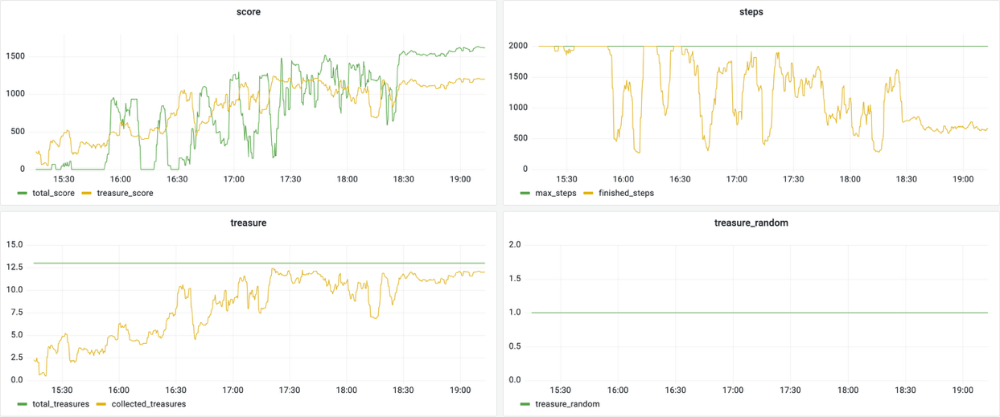
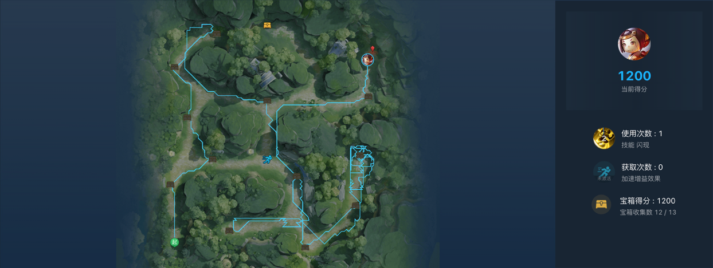

# 重返秘境

基于腾讯开悟平台的局部观测导航项目，使用 CNN 与 DQN 学习地图探索、避障、宝箱收集和终点导航。仓库包含 `agent_dqn` 和 `agent_target_dqn` 两套实现，分别侧重多分量奖励引导和阶段目标辅助决策。

## 任务简介

智能体控制鲁班，在有限步数内探索地图、收集宝箱并抵达终点。直接观察范围为周围的 51 × 51 区域，支持八方向移动和超级闪现，还可以利用地图中的加速增益提高移动效率。

成功到达终点后，任务得分计算为：

`总分 = 150 + (最大步数 - 完成步数) × 0.2 + 宝箱数量 × 100`

超时未到终点则得分为 0。详细任务说明见[项目介绍](project_introduction.md)。

## 实现方案

### 状态特征

输入由 404 维向量和 4 × 51 × 51 的局部地图组成。向量提供位置、目标方向和技能状态，地图保留障碍与历史访问的空间分布。

| 特征 | 维度 | 编码方式 |
| --- | --- | --- |
| 当前位置 | 258 | 两个归一化坐标，以及两个栅格坐标各 128 维的 one-hot 编码 |
| 当前导航目标 | 9 | 八方向 one-hot 加归一化距离，可根据策略阶段指向终点、宝箱或探索方向 |
| 候选点位信息 | 135 | 15 组相对位置，每组由八方向编码和距离组成；实际可收集宝箱最多 13 个 |
| 增益与闪现状态 | 2 | 标记加速增益和技能是否可用 |
| 局部地图 | 10404 | 障碍、目标路径、宝箱路径和访问记忆四个 51 × 51 通道 |

单个观测共 10808 个数值。预处理器还维护已发现宝箱、可见区域、访问次数和近期轨迹，用于目标选择、奖励计算和监控。

当前导航目标并非始终等于终点：`agent_dqn` 会使用宝箱目标替换部分终点方向特征，`agent_target_dqn` 则显式区分探索、采集和返回终点阶段。

### 动作与合法掩码

动作空间为 **16 个离散动作**：0～7 表示八方向普通移动，8～15 表示八方向闪现。动作通过 `move_dir + use_talent × 8` 编码，不是两个方向的笛卡尔积。

环境提供普通移动和闪现两类合法标记，学习器将其扩展为 16 维掩码。随机探索、Q 值选择以及下一状态的目标动作选择均应用掩码，避免选择冷却中的闪现。

### CNN 与 Dueling 网络

`agent_dqn` 使用四层卷积提取局部地图特征，卷积通道依次为 `4 → 16 → 32 → 64 → 8`，各层包含 BatchNorm 和 ReLU。展平后映射为 128 维地图表示，与向量特征拼接，再输入全连接骨干网络：

```text
404 维向量 ──────────────────────────┐
                                    ├── 拼接 532 维
4 × 51 × 51 地图 → CNN → 128 维 ─────┘
                                            ↓
                                  MLP：532 → 256 → 128
                                      ├── V(s)：1 维
                                      └── A(s, a)：16 维
                                            ↓
                                      16 个动作 Q 值
```

Dueling 输出将状态价值与动作优势合并：

`Q(s, a) = V(s) + A(s, a) - mean_a A(s, a)`

这样可以分别学习当前位置的整体价值，以及某个移动或闪现动作相对于其他动作的收益。

### Double DQN 更新

两套实现都包含在线网络和目标网络。在线网络在下一状态的合法动作中选择 Q 值最大的动作，目标网络负责估计该动作的价值：

`a* = argmax_a Q_online(s', a)`

`y = r + γ × (1 - done) × Q_target(s', a*)`

学习器以所执行动作的 Q 值逼近目标值 `y`，使用 Smooth L1 损失、Adam 和最大范数为 1.0 的梯度裁剪。目标网络每 500 次更新从在线网络完整复制参数，其余步骤按 `τ = 0.01` 软更新。

交互时使用 ε-greedy：训练初期优先随机探索，随预测调用次数增加逐渐降低随机率；评估时使用确定性策略。样本交由平台回放服务管理，当前配置容量为 4096，使用均匀采样，训练批次大小为 256。

每条样本保存当前与下一观测、两组合法标记、动作、奖励、回报字段和终止标记，序列化长度为 21624。特征维度与样本配置需要同步维护。

### 探索与奖励塑形

`agent_dqn` 将奖励拆成目标推进、资源收集、探索覆盖和行为约束等部分，缓解仅在终点获得反馈造成的稀疏奖励问题。

| 奖励类别 | 主要设计 |
| --- | --- |
| 目标推进 | 根据终点和已发现宝箱的距离变化提供反馈，结合收集进度判断何时转向终点 |
| 宝箱收集 | 奖励新发现宝箱、靠近近期目标和实际收集宝箱 |
| 地图探索 | 奖励首次访问、新增视野覆盖、覆盖率里程碑和向探索边界推进 |
| 区域覆盖 | 针对地图下半区与右下区域设置覆盖引导，减少遗漏区域 |
| 技能与增益 | 结合闪现实际位移、目标进展和加速增益获取情况计算奖励 |
| 行为约束 | 惩罚撞墙、停滞、重复访问、小范围转圈和时间消耗 |
| 终点约束 | 在宝箱和探索不足时抑制过早抵达终点，满足条件后提供终局奖励 |

探索阶段与目标阶段采用不同权重。当前以 75% 视野覆盖率作为切换参考：前期将目标类奖励缩放为 0.35，保留探索权重；后期恢复目标奖励，探索类权重缩放为 0.25。配置还设置了 15%、30%、45%、60%、75% 的覆盖里程碑。

这些是训练奖励，不改变环境的完成条件或实际评分。当前取宝门槛、覆盖阈值和区域偏好属于人工先验，需要通过消融实验判断收益。

### 阶段目标辅助版本

`agent_target_dqn` 保留相同输入格式和 Dueling、Double DQN 更新，另加入阶段目标选择与动作引导：

1. 根据视野覆盖、宝箱收集进度和时间判断探索、采集或终点阶段。
2. 探索和采集阶段优先选择已知宝箱，其次考虑附近增益和探索目标；终点阶段切换为返回终点。
3. 利用局部可通行地图和搜索生成目标方向，并对对应动作的 Q 值添加方向偏置。
4. 评估时存在明确目标方向的规则接管，同时检查局部可通行性；探索目标下，满足条件时可选择闪现。

因此，这个版本是学习与规则结合的方案，评估动作不完全由原始 Q 值决定。目录名 `target_dqn` 只是算法入口名称，不表示另一套 `agent_dqn` 没有目标网络。

该版本采用更小的网络：卷积通道为 `4 → 8 → 16 → 32 → 4`，当前地图嵌入为 64 维，拼接后为 468 维，骨干网络为 `468 → 128 → 64`。配置来自构造时传入的参数，而非模型类的默认值。

### 主要参数

| 参数 | `agent_dqn` | `agent_target_dqn` |
| --- | --- | --- |
| 地图嵌入维度 | 128 | 64 |
| 折扣因子 γ | 0.95 | 0.995 |
| 学习率 | 1e-4 | 1e-4 |
| 初始 / 最小 ε | 1.0 / 0.1 | 1.0 / 0.05 |
| ε 衰减预测调用数 | 600000 | 300000 |
| 目标网络硬更新间隔 | 500 次更新 | 500 次更新 |
| 目标网络软更新系数 | 0.01 | 0.01 |
| 每批样本梯度更新次数 | 1 | 2 |

## 实验结果

课程实验以 DQN 为主要方案，使用 2000 步上限和随机宝箱设置。以下为历史记录，不作为当前两套实现之间的对照评测。

| 场景 | 设置 | 结果 |
| --- | --- | --- |
| 资源收集测试 | 随机 13 个宝箱，最多 2000 步 | 单局约 600 步收集 12 个宝箱 |
| 宝箱数量变化测试 | 随机 9 个宝箱，最多 2000 步，共 10 局 | 10 局均完成；面板显示平均得分 1222、平均步数 635、平均收集 8 个宝箱 |

9 宝箱测试体现了该组设置下的适应情况，但不足以证明对所有地图与宝箱分布的泛化能力。尚未进行统一条件下的算法对比或系统奖励消融。

### 训练曲线



训练后段，得分与宝箱收集数量有所提高，完成步数降低。图中展示的是环境指标，不是累计塑形奖励；曲线本身不能区分 CNN、奖励项和训练时长各自的贡献。

### 宝箱收集路径



轨迹显示了多区域探索和宝箱收集过程。画面中的 1200 是回放时显示的分数，与 12 个宝箱的收益对应；不将这一数值作为最终结算总分。

### 随机 9 宝箱评估


评估面板显示平均收集 8 个宝箱、平均完成步数 635。以上截图仅保留实验区域，已移除姓名、账号、任务链接等信息。

## 代码结构

路径相对于 `back_to_the_realm/`：

| 路径 | 内容 |
| --- | --- |
| [agent_dqn/agent.py](../agent_dqn/agent.py) | 观测编码、动作转换和模型接口 |
| [agent_dqn/model/model.py](../agent_dqn/model/model.py) | CNN 与 Dueling 网络 |
| [agent_dqn/algorithm/algorithm.py](../agent_dqn/algorithm/algorithm.py) | Double DQN 更新、合法掩码和探索策略 |
| [agent_dqn/feature/preprocessor.py](../agent_dqn/feature/preprocessor.py) | 地图预处理、访问记忆与探索信息 |
| [agent_dqn/feature/definition.py](../agent_dqn/feature/definition.py) | 奖励计算和样本序列化 |
| [agent_dqn/workflow/train_workflow.py](../agent_dqn/workflow/train_workflow.py) | 环境交互、样本发送和指标监控 |
| [agent_target_dqn](../agent_target_dqn/) | 轻量网络与阶段目标辅助版本 |
| [conf](../conf/) | 平台训练配置和算法入口 |

## 运行说明

项目依赖开悟平台的 `kaiwu_agent`、`kaiwudrl`、`arena_proto` 和 `tools` 等模块，需要在匹配的平台环境中运行。

- 算法入口为 `dqn` 或 `target_dqn`，对应配置位于 `conf/algo_conf_back_to_the_realm.toml`；已删除的 `diy` 入口尚未清理。
- 当前两套环境配置均为起点编号 2、终点编号 1、随机 13 个宝箱、最大 2000 步。复现 9 宝箱评估时需单独调整环境配置。
- `agent_dqn` 当前提前终点约束使用至少 11 个宝箱的固定门槛，改为较少宝箱时应同步检查，避免产生无法满足的训练目标。

## 后续改进

统一评估配置与随机种子后，可比较两套实现的完成率、得分、收集数量、步数和推理开销。优先验证覆盖奖励、提前终点约束、目标偏置及规则接管各自的效果，再考虑用注意力机制或更丰富的地图记忆表达远距离目标关系。

任务规则参考[腾讯开悟重返秘境官方环境说明](https://tencentarena.com/docs/p-edu-back_to_the_realm/18.0.2/env-guide/)。
