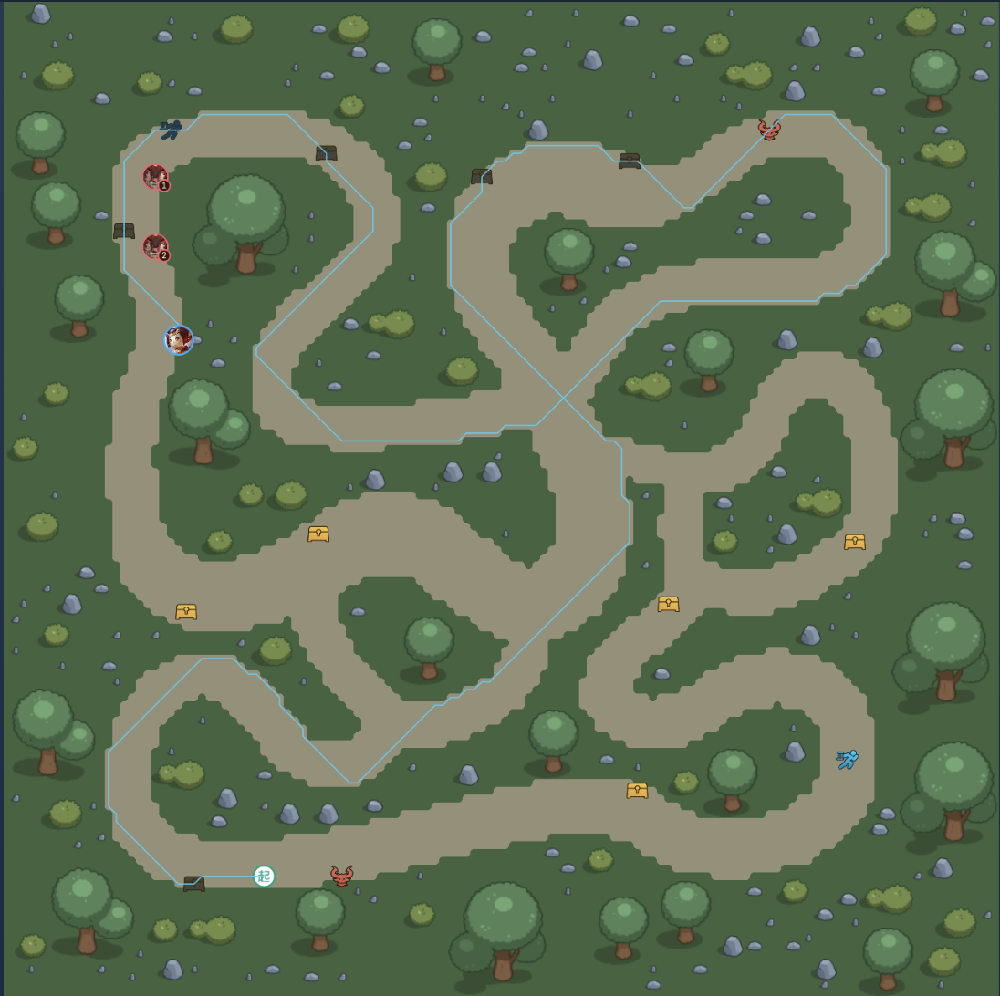
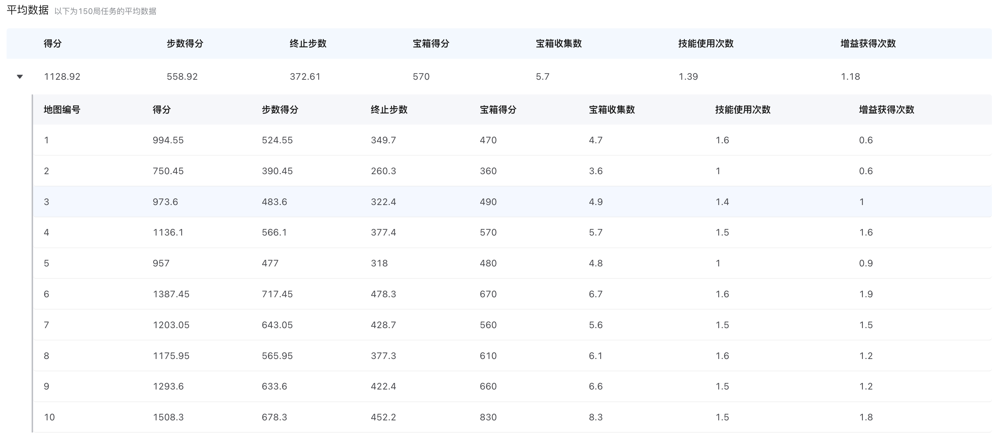

# 峡谷追猎

基于腾讯开悟平台的追逃与资源收集项目，采用 CNN + MLP 双分支 PPO，并结合局部 BFS、怪物威胁追踪、闪现落点模拟和规则辅助决策，在追击压力下兼顾生存与宝箱收益。

## 任务简介

智能体控制鲁班七号，在 128 × 128 栅格地图中躲避最多两只怪物，同时收集宝箱和加速增益。直接视野为周围的 21 × 21 区域，动作包含八方向移动和八方向闪现，共 16 种选择。

`总分 = 完成步数 × 1.5 + 宝箱收集数量 × 100`

怪物不可攻击，靠近到捕获范围会结束任务。任务重点是根据局部地形和怪物位置持续选择逃生路线，而不是单纯追逐最近宝箱。详细规则见[项目介绍](PROJECT_INTRODUCTION.md)。

## 实现方案

### 怪物定位与威胁追踪

预处理器分别维护两只怪物的信息，包括是否在视野内、位置、速度、相对方向、距离和接近趋势。怪物在视野内时，结合坐标计算精确几何特征，并在局部地图上查询路径距离；视野外主要使用环境提供的距离分桶和方向信息。

每只怪物编码为 10 维特征：可见标记、两个位置坐标、速度、欧氏距离、BFS 距离或分桶距离、方向余弦、方向正弦、方向未知标记和距离变化。方向采用正弦、余弦表示，保留相邻方向的连续关系。

距离变化使用“当前英雄位置到怪物当前及上一位置的距离差”，反映怪物运动带来的接近或远离趋势，不是双方相对运动的完整预测。代码还记录最近 10 步英雄轨迹，在第二只怪物出现前，根据出生时间和历史位置构造出生点相对方向与倒计时提示，减少在预期出生位置附近停留。

这里的“寻敌”指识别追击者及其威胁方向，用于提前避让，不包含主动攻击怪物。

### 距离计算与局部路线搜索

不同距离用于不同层次的判断：

| 距离或几何信息 | 计算方式 | 用途 |
| --- | --- | --- |
| 欧氏距离 | `sqrt(dx² + dz²)` | 描述直线接近程度，近距离避让使用平方距离比较 |
| 局部路径距离 | 在可通行格子上进行八方向 BFS | 考虑障碍绕行，比较怪物、宝箱和增益的实际局部路径 |
| 近邻范围 | `max(abs(dx), abs(dz))` | 判断怪物是否进入周围 3 × 3 邻域，或宝箱是否在邻格 |
| 环境分桶距离 | 使用环境返回的距离等级 | 在精确局部路径信息不足时提供粗略远近信息 |

地图数组使用 `map_grid[z, x]` 索引，与环境中的 `(x, z)` 坐标保持对应。BFS 将普通和斜向移动都计为一步；斜向移动除目标格可通行外，还要求相邻两条直边至少一条可通行，避免穿过封闭墙角。

每步从英雄位置执行一次 BFS，同时生成所有局部格子的最短步数和对应的第一步方向。这样可以复用一次搜索结果查询多个目标，而不必对每个宝箱重复寻路。

宝箱优先按局部可达性和路径距离排序，选取前三个编码；加速增益选取一个局部路径较近的目标。特征同时保留几何方向与 BFS 第一步方向，使策略区分“目标在哪边”和“绕障后应该先往哪边走”。

搜索范围仅限当前局部地图。返回不可达不代表全局不存在绕行路线；代码也没有根据视野外分桶信息恢复精确怪物位置。

### 地形检测与闪现落点

普通移动前计算八方向通行掩码，屏蔽向障碍物移动的动作。另沿八个方向发射最长 10 格的障碍射线，记录各方向能够连续前进的距离，用于判断通道、墙角及局部受困程度。

闪现候选按八个方向分别模拟：

1. 直线方向最大 10 格，斜向最大 8 格。
2. 从最远目标格向内查找可通行落点，允许跨过中间障碍。
3. 保存落点相对位移，并统计代码模拟路径上的宝箱和增益数量。
4. 结合技能冷却、环境闪现掩码和非零落点，生成可用闪现动作。

该几何模型为网络提供闪现后的空间变化信息，并供逃生规则比较候选落点，不只是简单选择与怪物相反的方向。

### 状态特征与网络

观测分为六通道地图和 130 维符号特征：

| 输入 | 内容 |
| --- | --- |
| `6 × 21 × 21` 地图 | 障碍、宝箱、加速增益、可见怪物、英雄位置、最近轨迹 |
| 英雄与怪物信息 | 英雄位置、技能和增益状态，两只怪物的位置、速度、距离及方向 |
| 目标信息 | 三个宝箱和一个增益的距离、方向与可达性 |
| 几何与动作信息 | 障碍射线、八方向闪现落点、上一动作、移动与闪现掩码 |
| 时间与历史信息 | 剩余预算、收集进度、第二只怪物出生提示和防停滞提示 |

轨迹通道保留最近 10 步位置，并按时间衰减，帮助识别短时间内的回访和绕圈。防停滞特征比较当前与 10 步前的位置，位移小于 5 格时触发对应惩罚。

网络采用双分支 Actor-Critic：

```text
6 × 21 × 21 地图 → CNN → 32 维 ─────┐
                                   ├── 拼接 96 维
130 维符号 → MLP：130 → 128 → 64 ──┘
                                          ↓
                                 融合 MLP：96 → 128 → 64
                                     ├── Actor：16 个动作 logits
                                     └── Critic：1 个状态价值
```

CNN 通道为 `6 → 16 → 32 → 32`，配合最大池化和全局平均池化提取空间信息。符号分支补充明确的几何和追击信息，融合后输出动作分布与状态价值。

### 规则辅助决策

策略网络给出候选动作后，规则层按优先级处理即时危险与易获取资源：

1. **合法性检查**：屏蔽撞墙移动、冷却中的闪现及无有效位移的闪现方向。
2. **紧急闪现**：怪物局部路径距离较小时触发逃生。当前阈值为前期不超过 2 步、怪物加速后不超过 3 步；进入近邻范围也会触发检查。
3. **近距离避让**：普通移动若朝向欧氏距离两格内的怪物，尝试改选其他通行方向。
4. **开局取宝保护**：前 10 步内，若宝箱方向与最近怪物方向接近，避免直接向该方向取宝。
5. **邻格取宝**：在满足相应检查后，优先拾取相邻可达宝箱；其余情况执行 PPO 动作。

逃生候选通过移动后或闪现落点到怪物的局部 BFS 距离打分。缺少可用局部信息时，回退为方向夹角和位移长度比较。当前实现会把局部不可达作为高分候选，这是一种启发式偏好，不能保证对两只怪物或视野外路线都安全。

规则在训练预测和评估中均可介入，最终表现属于 PPO 与规则的组合结果。代码保留网络概率、原始采样动作和接管次数，便于分析策略对规则的依赖；保留网络概率本身并不消除规则接管带来的行为分布差异。

### 奖励设计

奖励随怪物速度切换侧重点：前期鼓励取宝，怪物加速后提高生存和加速增益的权重。

| 奖励项 | 设计目的 |
| --- | --- |
| 宝箱拾取和新发现宝箱 | 提供采集反馈，鼓励探索新资源 |
| 加速增益 | 后期提高奖励，帮助应对加速怪物 |
| 生存奖励 | 持续存活获得反馈，后期权重更高 |
| 闪现收益 | 前期鼓励利用闪现路径获取资源，后期鼓励拉开怪物路径距离 |
| 无效行为惩罚 | 抑制撞墙、死角停留、小范围磨蹭及部分阶段的浪费闪现 |
| 终局反馈 | 结合生存结果与环境总分提供额外奖励 |

此外，使用势函数将“接近宝箱”和“远离怪物”结合为稠密反馈：

`Φ(s) = 0.3 × (1 - clip(d_treasure / 42)) + 0.5 × clip(d_monster / 42)`

`r_potential = γ × Φ(s_next) - Φ(s)`

其中 `clip` 将距离比例限制到 0～1，距离来自局部 BFS 或对应默认值。该反馈用于减少奖励稀疏，不能替代最终任务得分。

### PPO 更新与训练配置

轨迹通过 GAE 计算优势和回报目标，使用裁剪策略损失、裁剪价值损失与熵正则联合更新，并监控近似 KL、裁剪比例和梯度稳定性。

| 参数 | 当前值 |
| --- | --- |
| 折扣因子 γ / GAE λ | 0.995 / 0.97 |
| 学习率 | 3e-4 |
| PPO 裁剪范围 | 0.2 |
| 价值损失权重 | 1.0 |
| 熵系数 | 从 0.02 线性降低至 0.005 |
| 熵退火跨度 | 2000000 次学习更新 |
| 最大梯度范数 | 0.5 |

仓库保留四阶段课程配置，从较少地图、较少宝箱和延迟追击开始，逐渐增加地图数量、第二只怪物和加速压力。当前 `CURRICULUM_AUTO = False`，实际读取默认 `train_env_conf.toml`，不是自动推进课程；课程覆盖环境变量也需要启用课程后才生效。

## 实验结果

### 单局轨迹



单局结果图展示了跨多个通道的移动轨迹、宝箱收集与双怪追击情形，可用于观察避障、路线选择和局部回访。图片没有给出该局最终步数或完整结算数据，因此不从轨迹推定具体得分，也不将其作为训练收敛曲线。

### 总体评测



比赛评测汇总了 **150 局任务**，总体平均指标如下：

| 指标 | 平均值 |
| --- | --- |
| 总得分 | 1128.92 |
| 步数得分 | 558.92 |
| 终止步数 | 372.61 |
| 宝箱得分 | 570 |
| 宝箱收集数量 | 5.70 |
| 技能使用次数 | 1.39 |
| 增益获取次数 | 1.18 |

总得分由生存步数和宝箱收益共同贡献。平均终止步数说明仍有继续提升生存时长的空间，不能把该组结果描述为稳定存活至任务上限。

截图展示的地图 1～10 分项如下，未推定每张地图的测试局数：

| 地图 | 得分 | 步数得分 | 终止步数 | 宝箱得分 | 宝箱数 | 技能次数 | 增益次数 |
| --- | --- | --- | --- | --- | --- | --- | --- |
| 1 | 994.55 | 524.55 | 349.7 | 470 | 4.7 | 1.6 | 0.6 |
| 2 | 750.45 | 390.45 | 260.3 | 360 | 3.6 | 1.0 | 0.6 |
| 3 | 973.60 | 483.60 | 322.4 | 490 | 4.9 | 1.4 | 1.0 |
| 4 | 1136.10 | 566.10 | 377.4 | 570 | 5.7 | 1.5 | 1.6 |
| 5 | 957.00 | 477.00 | 318.0 | 480 | 4.8 | 1.0 | 0.9 |
| 6 | 1387.45 | 717.45 | 478.3 | 670 | 6.7 | 1.6 | 1.9 |
| 7 | 1203.05 | 643.05 | 428.7 | 560 | 5.6 | 1.5 | 1.5 |
| 8 | 1175.95 | 565.95 | 377.3 | 610 | 6.1 | 1.6 | 1.2 |
| 9 | 1293.60 | 633.60 | 422.4 | 660 | 6.6 | 1.5 | 1.2 |
| 10 | 1508.30 | 678.30 | 452.2 | 830 | 8.3 | 1.5 | 1.8 |

地图 10 的平均得分和收集数量最高，地图 6 的生存步数最高；地图 2 的得分与终止步数较低。不同地图的差异提示后续需要分别分析通道布局、追击压力和资源路线，但仅凭汇总表不能确定具体原因。

这些指标来自上述评测截图，未在本次整理中重新训练或评测，也没有据此推定当前源码对应的模型版本。

## 代码结构

路径相对于 `gorge_chase/`：

| 路径 | 内容 |
| --- | --- |
| [agent_ppo/agent.py](../agent_ppo/agent.py) | 观测处理、网络推理、规则接管及模型接口 |
| [feature/preprocessor.py](../agent_ppo/feature/preprocessor.py) | 怪物追踪、特征构建、事件检测和奖励计算 |
| [feature/bfs.py](../agent_ppo/feature/bfs.py) | 局部 BFS、通行判断、障碍射线和闪现模拟 |
| [feature/rules.py](../agent_ppo/feature/rules.py) | 紧急逃生、近怪避让和邻格取宝 |
| [model/model.py](../agent_ppo/model/model.py) | CNN + MLP 双分支 Actor-Critic |
| [algorithm/algorithm.py](../agent_ppo/algorithm/algorithm.py) | PPO 更新、熵退火及训练诊断 |
| [feature/definition.py](../agent_ppo/feature/definition.py) | 样本协议与 GAE |
| [workflow/train_workflow.py](../agent_ppo/workflow/train_workflow.py) | 环境交互、课程配置和指标上报 |
| [agent_ppo/conf](../agent_ppo/conf/) | 超参数、默认环境和四阶段环境配置 |

## 运行说明

项目依赖腾讯开悟平台的 `kaiwudrl`、`common_python` 和 `tools` 等接口，需要在匹配的平台环境中运行。

- 当前默认训练使用地图 1～10、10 个宝箱、2 个增益和 1000 步上限，按顺序选择地图。
- 默认配置为闪现冷却 200 步、第二只怪物在 200 步出现、怪物在 300 步加速、增益冷却 80 步；与课程阶段配置及任务默认值分别管理。
- 超参数与规则阈值以代码为准，部分函数注释仍保留旧数值。

## 后续改进

优先评估不同地图上的生存差异，以及闪现时机、落点选择和规则接管比例。可分别关闭邻格取宝、紧急闪现与势函数奖励进行消融，并完善局部不可达情况下的风险处理，避免将局部搜索失败等同于安全。

任务规则参考[腾讯开悟峡谷追猎官方环境说明](https://tencentarena.com/docs/p-competition-gorge_chase/15.0.1/guidebook/env/)。
