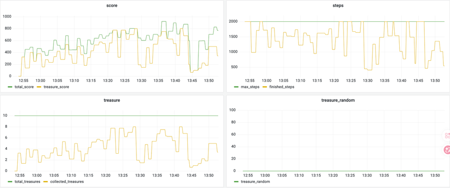
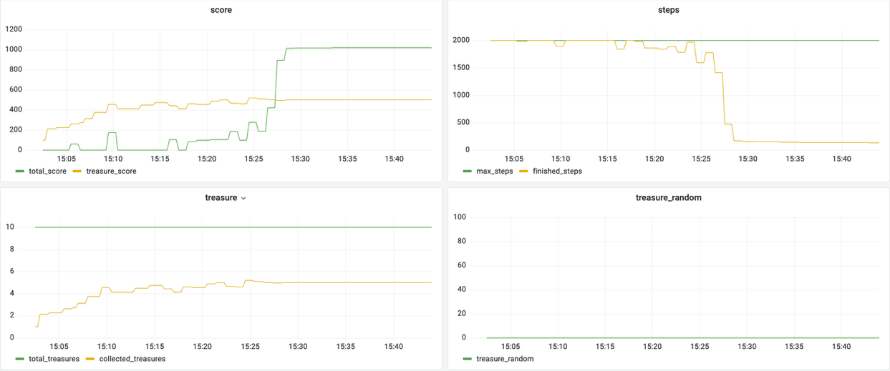

# 峡谷漫步

基于腾讯开悟平台的网格路径规划项目，包含 PPO 和动态规划两种实现，用于完成避障、宝箱收集和终点导航任务。

## 任务简介

智能体在 64 × 64 的地图中，通过上下左右四个方向移动，在有限步数内收集宝箱并到达终点。直接视野为周围的 5 × 5 区域，地图中最多配置 10 个宝箱。

成功到达终点后，得分计算为：

`总分 = 150 + (最大步数 - 完成步数) × 0.2 + 宝箱数量 × 100`

超时未到终点则得分为 0。详细任务说明见[项目介绍](PROJECT_INTRODUCTION.md)。

## 实现方案

### PPO

PPO 通过环境交互学习移动策略。每一步先构建状态特征，再由策略网络选择动作，执行后计算奖励并保存样本；一局结束后，使用收集到的轨迹更新网络。

#### 状态特征

输入为 250 维向量，将位置、目标信息和局部环境统一编码：

| 特征 | 维度 | 编码方式 |
| --- | --- | --- |
| 当前位置 | 129 | 一个归一化位置编号，加上两个坐标各 64 维的 one-hot 编码 |
| 目标距离 | 11 | 到终点和 10 个宝箱的距离，截断到 150 后归一化 |
| 局部地图 | 75 | 将 5 × 5 视野分别编码为障碍、宝箱和终点三个二值通道，再展平 |
| 访问记忆 | 25 | 提取当前位置周围的访问记录，限制到 0～1 范围 |
| 宝箱状态 | 10 | 标记各宝箱是否仍可收集 |

距离特征提供导航方向的间接依据，局部地图用于识别障碍与附近目标，访问记忆用于减少重复探索。局部地图在当前实现中展平后交给 MLP，没有使用 CNN。

#### Actor-Critic 网络

网络先通过共享特征层提取 128 维表示，再分别输出动作和状态价值：

```text
250 维状态
    ↓
共享 MLP：250 → 256 → 256 → 128
    ├── Actor：128 → 64 → 4   移动动作 logits
    └── Critic：128 → 64 → 1  状态价值
```

隐藏层使用 Tanh 激活。Actor 的 logits 构成离散动作分布，训练时从中采样以保持探索，确定性预测时选择最大 logits 对应的动作。Critic 估计当前状态的未来回报，为优势计算提供基准。

#### 奖励设计

奖励塑形主要处理原地停滞、取宝后打转、过早前往终点和绕墙困难等问题：

| 奖励项 | 设计目的 |
| --- | --- |
| 步数惩罚 | 随任务进程逐步提高时间成本，减少无效移动 |
| 得分增长与取宝奖励 | 对获得收益和收集宝箱提供直接反馈 |
| 阶段目标引导 | 根据预设宝箱顺序，奖励接近当前目标的动作 |
| 附近宝箱引导 | 当其他宝箱距离较近时，允许顺路收集 |
| 探索奖励 | 鼓励进入未访问格子，奖励强度随时间衰减 |
| 停滞与重复访问惩罚 | 抑制撞墙、原地不动和反复横跳 |
| 障碍区宽恕 | 在障碍密集区域减轻绕远和回访惩罚，为绕墙保留空间 |
| 终点引导与终局反馈 | 后期转向终点，对成功到达和超时分别给予奖励与惩罚 |

当前实现超过 1400 步、估计已收集至少 7 个宝箱，或剩余预算不超过 300 步时，会进入终点导向模式。障碍区通过 5 × 5 局部障碍比例判断，密度超过 0.25 时减轻部分惩罚。

这些奖励与环境评分分别计算。阶段目标使用固定宝箱顺序，因此策略训练包含人工规划先验；相关阈值也依赖当前 2000 步预算。奖励文件中保留了注释形式的历史版本，实际生效的是最后一个 `reward_shaping` 定义。

#### 样本与策略更新

单步样本保存当前状态、动作、旧策略下的动作对数概率、塑形奖励、终止标记、状态价值和下一状态，共 505 个数值。工作流在一局结束后将样本交给学习器。

更新过程如下：

1. 利用奖励、状态价值和下一状态价值反向计算 GAE 优势与回报目标，再对优势标准化。
2. 对同一批轨迹进行多轮更新，每轮打乱样本并划分小批次。
3. 计算新旧策略的动作概率比，使用 PPO 裁剪目标限制策略更新幅度。
4. 联合优化策略损失、价值均方误差和熵正则，并对梯度范数裁剪。

总损失为 `策略损失 + 0.5 × 价值损失 - 0.01 × 策略熵`。当前配置如下：

| 参数 | 数值 |
| --- | --- |
| 折扣因子 γ / GAE λ | 0.95 / 0.95 |
| PPO 裁剪范围 ε | 0.2 |
| 共享层与 Actor 学习率 / Critic 学习率 | 3e-4 / 1e-3 |
| 每批更新轮数 / 小批次大小 | 4 / 256 |
| 最大梯度范数 | 0.5 |

工作流定期上报回报、步数和任务完成指标，并保存最新模型及单局塑形回报最高时的模型。后者按训练回报选择，不等同于独立评估中的最高得分模型。

### 动态规划

动态规划利用已知地图转移表直接计算动作策略，适用于固定地图和预设宝箱目标。它不依赖神经网络交互训练，求解结果保存为策略表，执行时根据状态查表选取动作。

#### 地图与阶段状态

工作流读取 `conf/map_data/F_level_1.json`，其中记录位置执行动作后的下一位置、基础奖励和终止信息。原始位置按 `position_id = x × 64 + z` 编号。

为区分同一位置在不同收集进度下的行动目标，规划状态扩展为：

`state = position_id × 11 + stage`

其中 `stage` 为 0～10，表示沿预设顺序已经推进的宝箱阶段，状态空间共 `4096 × 11 = 45056`。当前宝箱访问顺序为：

```text
0 → 1 → 2 → 4 → 5 → 9 → 8 → 3 → 6 → 7
```

运行时根据宝箱状态确定阶段，已收集或未生成的目标会被跳过。宝箱位置和访问顺序均来自配置，代码没有在线求解旅行商问题，也不保证该顺序在所有任务设置下最优。

#### 转移与规划奖励

每次评估一个状态下的动作时，先从地图表取得下一位置，再判断是否到达当前阶段要求的宝箱。命中阶段目标后推进阶段；到达其他宝箱位置不会推进当前规划阶段。

当前内部奖励使用普通移动成本 -0.2、地图表中的终点基础奖励，以及按顺序取宝时的额外奖励 1e5。无法在转移表中查到的动作赋予很低的动作价值，以避免选择。大额取宝奖励用于强化预设顺序，它并非环境真实给分。

#### 价值迭代与动作选择

默认使用价值迭代，以折扣回报比较四个方向的动作：

`Q(s, a) = r(s, a) + γ × V(s')`

`V(s) = max_a Q(s, a)`

初始化状态价值后，反复更新地图中存在的位置所对应的各个阶段。当一轮更新的最大变化小于 1e-3，或达到 250 轮上限时停止，折扣因子为 0.9。最终对动作价值取最大值，得到每个状态对应的确定性策略。代码也保留策略迭代分支。

求解时会将地图转移表的字符串键转为整数，并建立“宝箱位置到宝箱编号”的查询表，减少重复查找。预测时只需编码当前位置与阶段，再查询策略表，无需重新进行全图迭代。

这套方案的稳定性依赖已知转移和固定目标信息。更换地图、宝箱位置或访问顺序后，需要检查状态建模并重新求解；固定场景的表现不能直接代表未知地图上的泛化能力。

## 实验结果

| 方案 | 实验表现 |
| --- | --- |
| PPO | 约一小时训练后得分可达约 800 分，但仍有明显波动，未稳定收敛 |
| Q-learning | 历史对照实验后段得分约为 1000 分，完成步数明显下降；对应源码未保留 |
| 动态规划 | 作为最终任务方案，在已知地图和固定宝箱条件下完成路径规划 |

以下曲线为历史实验记录。不同方案的训练条件未严格对齐，结果不作为统一基准测试。

### PPO 训练曲线



### Q-learning 训练曲线



## 代码结构

路径相对于 `gorge_walk/`：

| 路径 | 内容 |
| --- | --- |
| [agent_ppo](../agent_ppo/) | PPO 智能体、特征处理、奖励、网络及训练工作流 |
| [agent_dynamic_programming](../agent_dynamic_programming/) | 动态规划智能体、求解器及阶段配置 |
| [conf](../conf/) | 平台配置和算法入口 |
| [conf/map_data](../conf/map_data/) | 地图状态转移数据 |

## 运行说明

项目依赖腾讯开悟平台提供的 `kaiwu_agent`、`kaiwudrl` 和 `tools` 等接口，需要在对应平台环境中运行。

- 当前两套方案均配置固定起终点、10 个宝箱和 2000 步上限。
- PPO 奖励函数包含与 2000 步预算相关的阈值，调整步数上限时需要同步检查。
- PPO 使用配置中的 `diy` 入口，动态规划使用 `dynamic_programming` 入口；其余已删除教学算法的配置入口尚未清理。
- 仓库不包含训练权重。历史截图与当前代码配置不保证完全一致。

任务规则参考[腾讯开悟峡谷漫步官方文档](https://tencentarena.com/docs/p-edu-gorge_walk/21.0.1/)。
