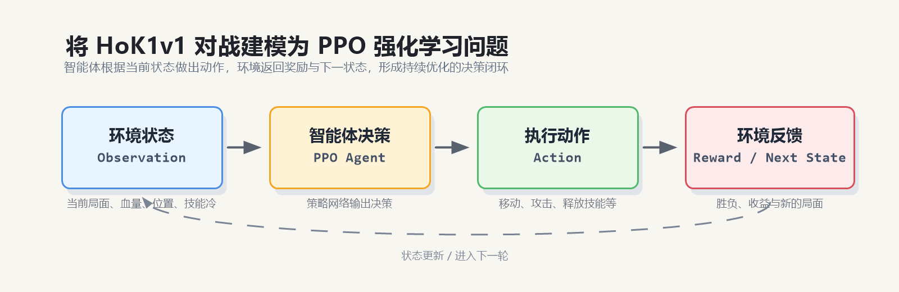
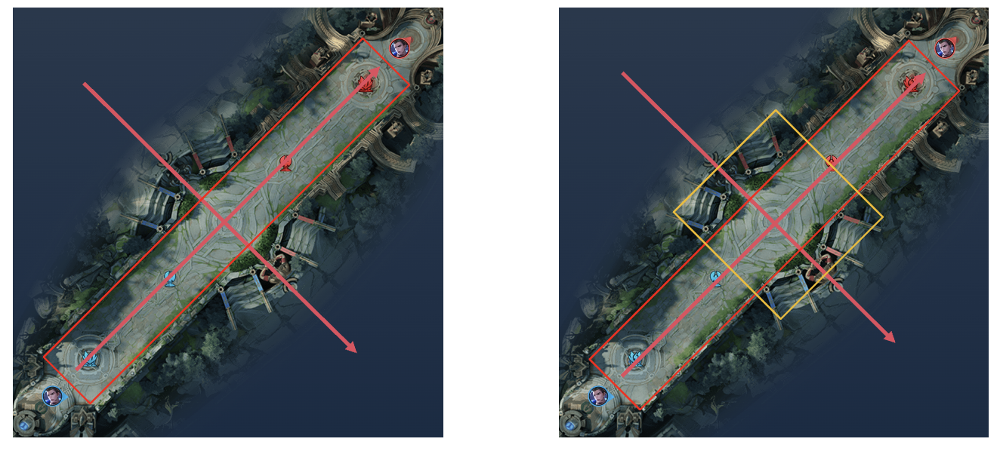
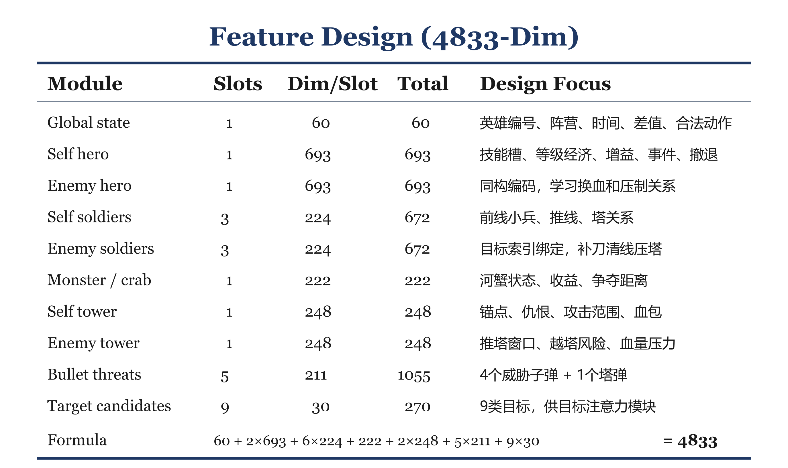
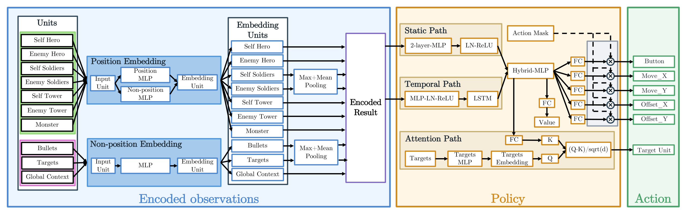
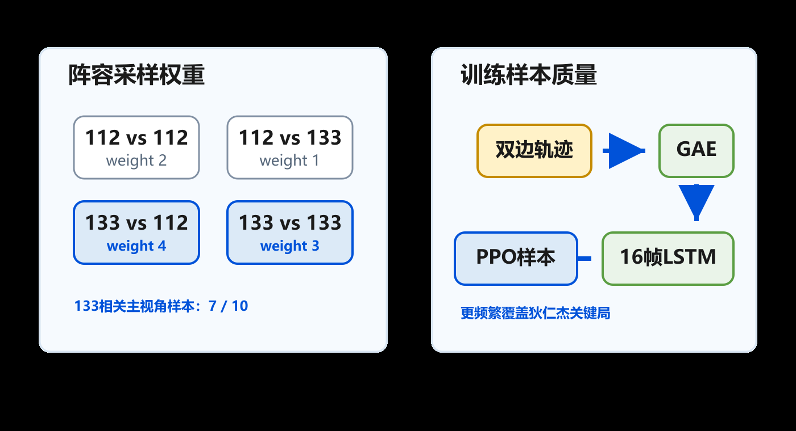
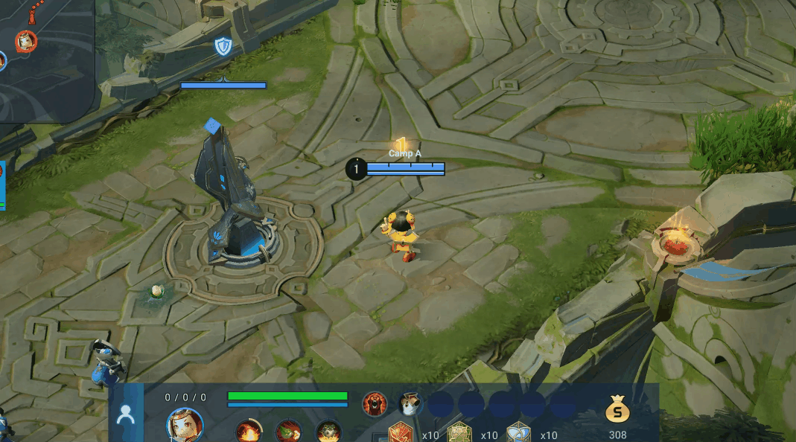
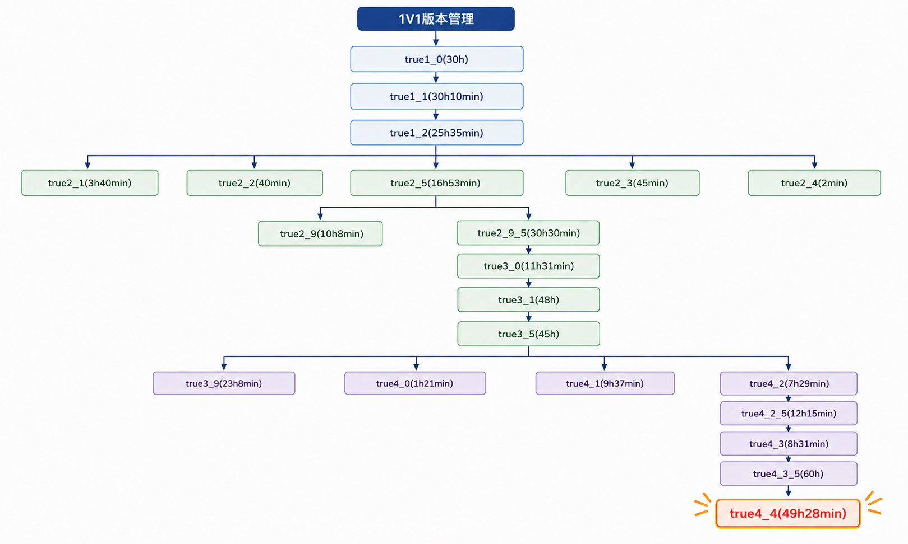

# 王者荣耀 1v1

基于腾讯开悟平台的实时对抗智能体，采用结构化特征、MLP 与 LSTM 融合网络、目标注意力和 Dual-clip PPO，并结合开局跟线、技能修正和低血撤退等工程规则，完成对线发育、交战与推塔决策。

## 任务简介

红蓝双方在墨家机关道各控制一名英雄，可使用鲁班七号（112）或狄仁杰（133）。智能体根据局面选择移动、攻击、技能和目标，在获取经济与经验的同时保护己方防御塔，并寻找摧毁敌方防御塔的机会。

任务以推掉敌方防御塔判定胜利，多局累计胜场作为评价依据。详细规则见[项目介绍](project_introduction.md)。



## 实现方案

### 统一视角与地图位置编码

地图沿对角线展开，直接使用原始 x、z 坐标会把“沿兵线推进”和“横向走位”混合在两个坐标轴中。特征处理先将红方坐标镜像到统一己方视角，再投影为沿兵线的 `lane` 轴和垂直兵线的 `width` 轴：

```text
红方视角：先令 x = -x，z = -z
lane  = (x + z) / sqrt(2)
width = (x - z) / sqrt(2)
```

这样，推进、撤退、贴近兵线和横向规避都能用统一语义表示，减少红蓝换边带来的重复学习。



左图展示覆盖全图主通道的坐标设计，右图叠加中央交战区域的精细编码。实现中同时保留两种尺度：全图编码帮助判断所属半场、塔与出生区域，中央编码区分对线距离与横向站位。

| 位置编码 | 沿兵线范围 / 单位 | 横向范围 / 单位 | 编码维度 |
| --- | --- | --- | --- |
| 中央精细编码 | ±22000 / 720 | ±14000 / 350 | 63 + 83 |
| 全图粗粒度编码 | ±45000 / 5000 | ±7000 / 3500 | 21 + 7 |
| 连续位置补充 | 两种尺度的归一化坐标与中心距离 | 同左 | 6 |

每个位置共 180 维，离散轴编码包含范围外的标记。两种尺度按轴分别编码，不是构建完整二维像素网格，也不是把截图送入 CNN；图中的划分用于说明结构化坐标的设计。

### 4833 维结构化特征

原始帧数据按全局态势、实体和动作目标拆分，避免把不同类型单位混在同一个无结构向量中。

| 模块 | 槽位数 | 每槽维度 | 总维度 | 主要信息 |
| --- | --- | --- | --- | --- |
| 全局状态 | 1 | 60 | 60 | 英雄身份、时间、局面差值与合法动作摘要 |
| 双方英雄 | 2 | 693 | 1386 | 位置、生命、经济等级、技能、增益和近期事件 |
| 双方小兵 | 6 | 224 | 1344 | 前线兵线、补刀、攻击目标和塔关系 |
| 河蟹 | 1 | 222 | 222 | 状态、距离及资源争夺信息 |
| 双方防御塔 | 2 | 248 | 496 | 血量、仇恨、攻击范围、血包及推塔压力 |
| 子弹威胁 | 5 | 211 | 1055 | 四个敌方英雄子弹槽与一个塔弹槽 |
| 候选目标 | 9 | 30 | 270 | 协议目标对应实体及其可选状态 |
| 合计 | | | **4833** | |



每类实体共享相应编码器。子弹特征结合历史位置估计运动方向、速度、接近趋势和最近接近距离，为躲避技能与塔弹提供时序线索。英雄特征保留身份和技能差异，使同一网络处理 112、133 及其镜像对局。

实体槽位与动作目标分别维护：当前小兵实体特征每方保留三个槽位，而协议目标仍包含四个敌方小兵索引。目标绑定需要与 `runtime_id` 和官方目标顺序一致，不能仅按距离重排。

### 实体编码与时序网络



网络对位置和单位公共属性共享编码，再通过英雄、小兵、塔、河蟹、子弹和候选目标各自的编码器提取表示。多实例实体使用池化汇总，再与全局态势拼接。

融合后的特征同时进入静态 MLP 和 LSTM 分支：静态分支保留当前局面，LSTM 利用历史信息理解技能过程、兵线变化及交战节奏。两路输出合并为 512 维公共表示。

```text
4833 维结构化观测
    ↓
共享位置编码 + 分类实体编码 + 多实例池化
    ↓
融合局面特征
    ├── 时序分支：投影 → LSTM（隐藏维度 512）
    └── 静态分支：MLP → 512 维
                    ↓
             融合为 512 维公共表示
                ├── 动作类别与方向输出
                ├── 候选目标注意力输出
                └── 状态价值输出
```

训练按 16 个连续采样时刻组织时序样本，并携带 LSTM 初始隐藏状态与细胞状态。模型没有使用地图图像输入，地图几何信息来自前述结构化位置特征。

### 多头动作与目标注意力

动作由六个子任务组成，输出维度为 `[12, 16, 16, 16, 16, 9]`，分别对应动作类别、移动方向参数、技能方向参数与目标选择。

前五个子任务由公共表示生成 logits。目标头则将九个候选目标编码为 32 维向量，与局面表示投影后的向量做缩放点积，为每个目标计算分数。相比只输出固定目标编号，这种设计使选择过程同时依赖当前局势与候选实体属性。

目标顺序包括无目标、敌方英雄、自身、四个敌方小兵槽、敌塔和河蟹。推理时结合 `legal_action` 和动作相关的目标掩码，训练时用 `sub_action_mask` 区分不同动作真正生效的子任务。

### Dual-clip PPO 更新

训练使用 GAE 构造优势与回报，先执行 PPO 概率比裁剪，再对负优势样本施加第二层下界：

```text
ratio = π_new(a|s) / π_old(a|s)
surrogate = min(ratio × A, clip(ratio, 1-ε, 1+ε) × A)
若 A < 0：surrogate = max(surrogate, c × A)
```

当前 `ε = 0.2`、`c = 3.0`。第二层裁剪限制负优势情况下过大的负向目标，训练同时使用价值损失、熵正则和梯度裁剪。

| 参数 | 当前值 |
| --- | --- |
| 折扣因子 γ / GAE λ | 0.995 / 0.95 |
| LSTM 时序长度 / 隐藏维度 | 16 / 512 |
| 公共表示 / 目标嵌入维度 | 512 / 32 |
| 初始学习率 / 目标学习率 | 3e-5 / 1e-5 |
| 熵系数 | 0.01 |
| PPO / Dual-clip 系数 | 0.2 / 3.0 |
| 优势标准化 | 开启 |
| 价值裁剪 | 当前关闭 |
| 最大梯度范数 | 0.5 |

特征维度、样本切分、模型输入与保存协议保持绑定，并通过配置校验和检查点协议检查降低版本不兼容风险。

### 奖励设计

训练奖励围绕最终推塔目标，覆盖基础发育、交战反馈和场景行为。奖励管理器逐项计算并输出加权值，便于检查高回报行为是否对应实际胜率提升。

| 奖励类别 | 内容 |
| --- | --- |
| 发育与消耗 | 金钱、经验、补刀、生命和法力变化 |
| 对抗与技能 | 击杀、阵亡、技能命中、狄仁杰净化和三技能后续伤害 |
| 建筑与兵线 | 塔血变化、己方小兵抗塔时的推进、敌兵压塔与塔下防守 |
| 恢复与资源 | 血包、低血恢复、敌方阵亡后的资源获取、河蟹争夺 |
| 开局与技能时机 | 上线站位、越线换血、狂暴使用及后续真实交互 |
| 终局与无效操作 | 胜负反馈，以及连续空动作惩罚 |

部分基础奖励使用前后帧变化和双方差值，事件类奖励通过命中与状态变化触发；不是所有项目都采用完全相同的零和形式。塔血奖励在低血量区间加强推塔收益，部分奖励还按时间或局势调整权重。

训练回报与比赛积分分别使用。当前终局胜负反馈为 ±3，连续无效动作达到 5 次时施加 -0.1 的训练惩罚。

### 工程规则

规则用于修正部分高频失误，模型仍负责大部分持续决策。规则是否介入及其触发次数会进入监控。

| 规则 | 主要处理 |
| --- | --- |
| 鲁班一技能瞄准 | 模型已选择一技能时，按可见目标修正方向与目标，不单凭规则强行释放 |
| 狄仁杰二技能保护 | 在镜像对局中结合敌方大招、命中与窗口信息保留净化机会 |
| 开局脱困 | 在开局 180～300 帧检测连续位置变化过小，必要时向前移动 |
| 开局兵线保护 | 先到一塔区等待，再按英雄节奏空 A、跟随兵线，遇到交战条件后退出脚本 |
| 低血撤退与返线 | 结合自身血量、敌距、塔血及兵线判断是否回泉，恢复后沿缓存路径返线 |

开局规则主要限制在 840 帧内。鲁班从 540 帧起安排 5 次空 A，狄仁杰从 510 帧起安排 6 次，间隔为 35 帧；约 686 帧后进入跟线阶段，避免抢在小兵之前吸引攻击。实际释放仍受动作合法性和退出条件约束。

回泉逻辑使用状态机管理。普通入口以血量低于约 20%、敌方距离大于 10000、己塔血量高于 30% 为基础条件，并结合血包、恢复技能与兵线状态进一步门控；击杀后还存在低于约 40% 血量的独立窗口。路径通过对局中的位置记录形成，撤退时反向沿路标移动，恢复至约 80% 后返线。卡点持续无进展时跳过路标，避免固定卡墙。

规则接管不等同于策略网络自行学会相同行为。样本构建会为规则或回城接管帧关闭训练标记，损失端据此应用训练权重；相关表现应作为混合策略整体评估。

## 训练与采样

训练覆盖四类英雄组合，并通过权重增加部分难局出现频率：

| 第一侧英雄 | 对侧英雄 | 采样权重 |
| --- | --- | --- |
| 鲁班 112 | 鲁班 112 | 2 |
| 鲁班 112 | 狄仁杰 133 | 1 |
| 狄仁杰 133 | 鲁班 112 | 4 |
| 狄仁杰 133 | 狄仁杰 133 | 3 |



图中的 `7/10` 对应第一侧为 133 的阵容权重之和。双方轨迹均采集且长度近似时，两侧合计的名义 133 占比约为 55%；实际样本比例还受对手类型、轨迹长度和有效训练标记影响，不能直接视为 70%。

工作流支持 `common_ai`、`selfplay` 和指定模型对手，按配置判断哪些阵营需要预测和采样。轨迹进入 GAE 与时序样本构建后发送给训练端，预测端加载更新后的模型继续交互。

## 效果展示与版本迭代

### 开局对线示例



该片段展示鲁班在一塔附近站位、随兵线向前移动并与敌方交战的过程，可结合开局规则阅读。单个片段用于说明行为，不作为规则消融或总体胜率证明。

### 训练版本



迭代过程围绕录像中暴露的开局、技能、恢复和推塔问题更新代码，并从已有模型继续训练或分支试验。图中的时间属于各版本记录，不直接累加为去重后的总训练预算。

### 阶段成绩

| 阶段 | 成绩记录 |
| --- | --- |
| 初赛 | 北部赛区第 10，晋级 |
| 第一次周赛 | 北部赛区第 3，对 baseline2 为 12:19 |
| 第二次周赛 | 北部赛区第 1，对 baseline3 为 3:1 |
| 第三次周赛 | 北部赛区第 1，对 baseline4 为 3:1 |
| 区域决赛 | 北部赛区第 1，对 baseline5 为 7:1 |


## 代码结构

路径相对于 `honor_of_kings_1v1/`：

| 路径 | 内容 |
| --- | --- |
| [agent_ppo/agent.py](../agent_ppo/agent.py) | 推理、合法动作处理、技能修正和撤退状态机 |
| [feature/feature_process.py](../agent_ppo/feature/feature_process.py) | 坐标投影、4833 维特征与目标绑定 |
| [feature/reward_process.py](../agent_ppo/feature/reward_process.py) | 奖励管理与事件反馈 |
| [model/model.py](../agent_ppo/model/model.py) | 实体编码、LSTM 融合、目标注意力及损失 |
| [algorithm/algorithm.py](../agent_ppo/algorithm/algorithm.py) | 样本拆分、优化和训练监控 |
| [feature/definition.py](../agent_ppo/feature/definition.py) | 轨迹采集、训练标记、GAE 与样本序列化 |
| [workflow/train_workflow.py](../agent_ppo/workflow/train_workflow.py) | 对手选择、阵容采样和训练循环 |
| [agent_ppo/conf/conf.py](../agent_ppo/conf/conf.py) | 几何范围、维度、奖励和规则参数 |
| [conf](../conf/) | 平台入口和运行配置 |

## 运行说明

项目依赖开悟平台的 `kaiwudrl`、`common_python` 和 `tools` 等模块，需要在匹配的环境中运行。

- 当前智能体目录为 `agent_ppo`，平台配置同时保留指向该实现的 `ppo`、`diy` 入口。
- 特征、动作掩码、样本维度和模型协议需要同步更新；旧权重不保证兼容当前实现。
- 当前训练候选召唤师技能限定为狂暴，支持的技能列表不代表每项都会参与实际采样。

## 后续改进

在统一对手、阵容和换边条件下，分别评估技能修正、开局脚本和撤退规则的贡献，并持续记录模型自主行为与规则接管比例。进一步探索对手池调度、多分量价值估计和河蟹资源决策，需与当前实现的效果分开验证。

实现思路参考 [kaiwu_taichu 的 hok_semi 项目](https://github.com/wty-yy/kaiwu_taichu/tree/2025/hok_semi)，并按当前英雄与平台协议适配。相关算法参考 PPO 与 *Mastering Complex Control in MOBA Games with Deep Reinforcement Learning*。
