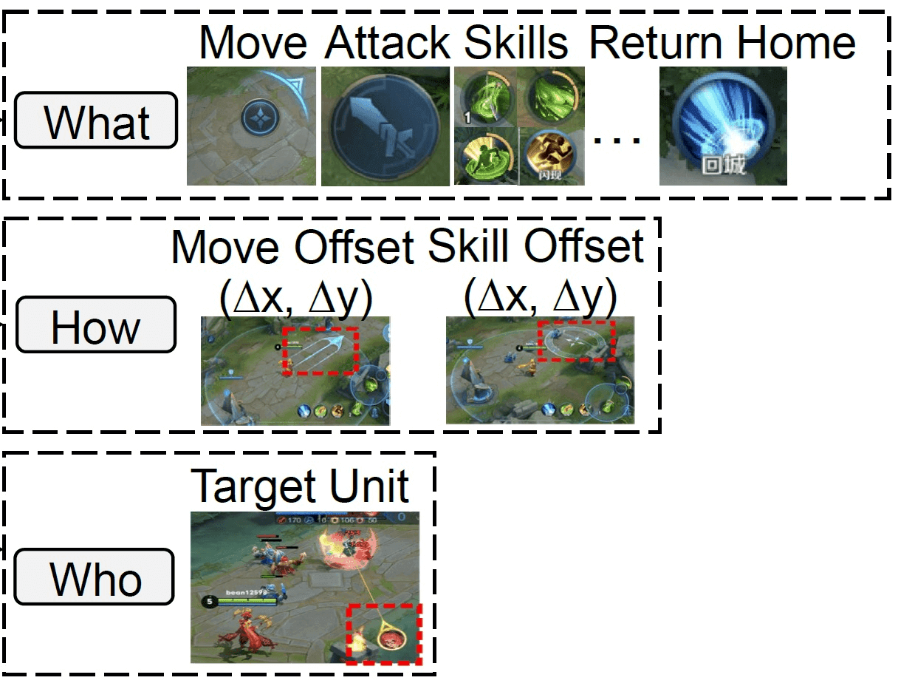
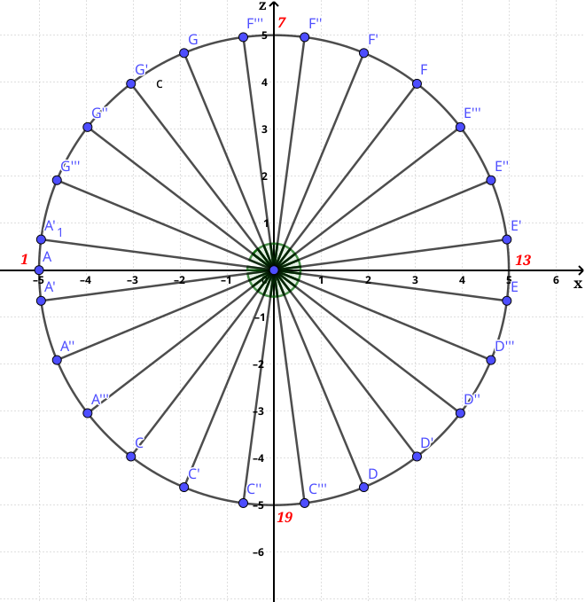
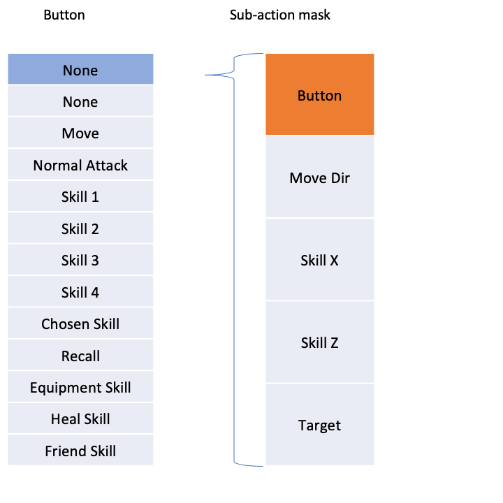
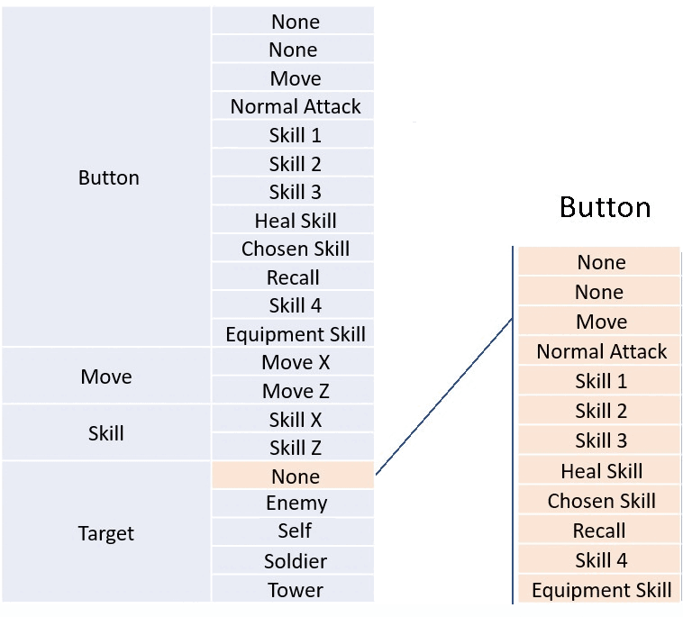
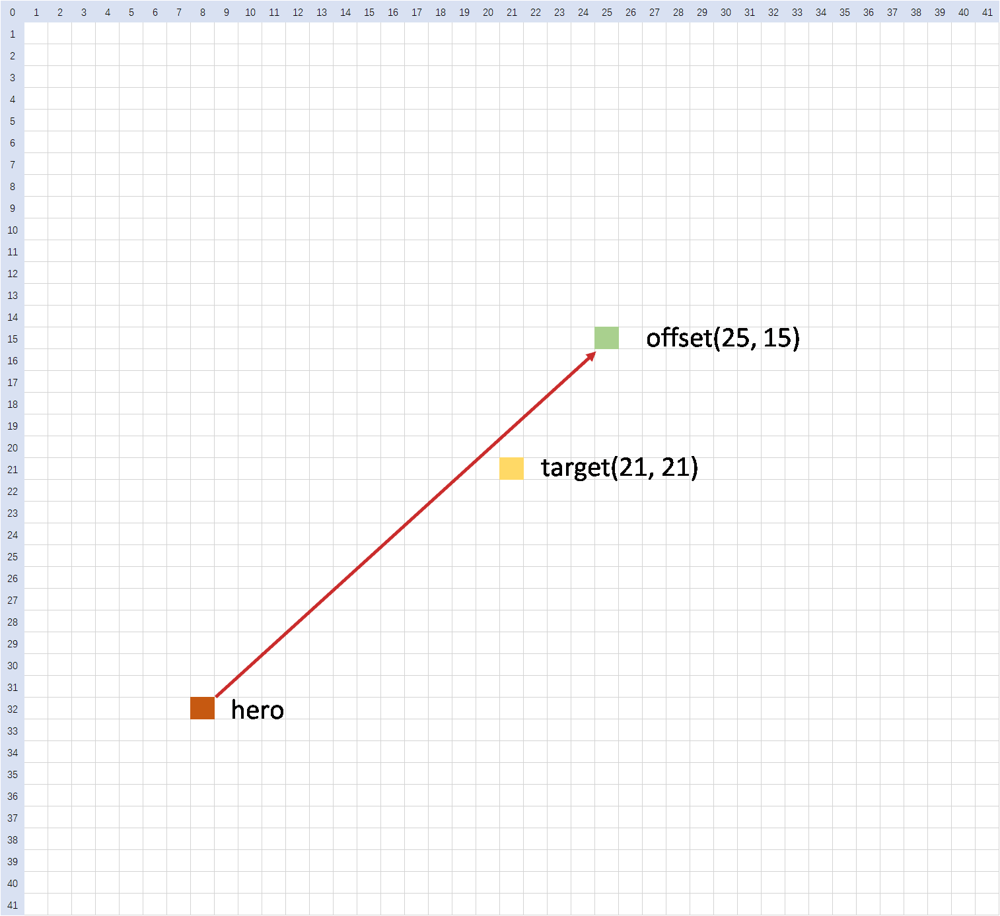
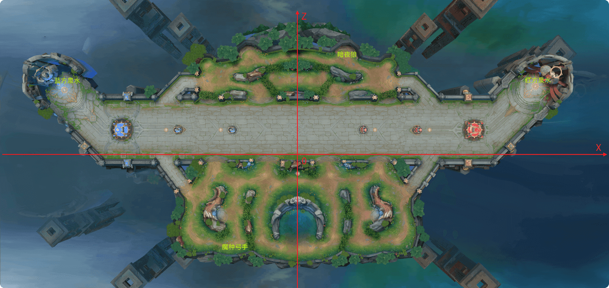

# 环境详述

## 环境配置

在智能体和环境的交互中，首先会调用`env.reset`方法，该方法接受一个`usr_conf`参数，这个参数通过读取`train_env_conf.toml`文件的内容来实现定制化的环境配置。因此，用户可以通过修改`train_env_conf.toml`文件中的内容来调整环境配置。

```python
# usr_conf为代码包中的train_env_conf.toml配置文件，此处以agent_ppo为例
usr_conf = read_usr_conf("agent_ppo/conf/train_env_conf.toml", logger)
observation, extra_info = env.reset(usr_conf=usr_conf)
```

`train_env_conf.toml`中包含以下配置信息：

| 配置名称 | 支持字段 | 字段描述 |
| --- | --- | --- |
| monitor | monitor\_side | 监控上报的阵营。类型整型，取值范围[0, 1]。0表示蓝方阵营，1表示红方阵营。 |
|  | auto\_switch\_monitor\_side | 是否启用自动换边逻辑，类型布尔值，true 表示开启，false 表示关闭。 |
| episode | opponent\_agent | 对手智能体。取值范围[selfplay, common\_ai, 自定义模型 id]，默认值"selfplay" 1. selfplay：自对弈2. common\_ai：与基于规则的common\_ai对战 3. 自定义的模型id：与指定的模型对战，需要先将模型上传至模型管理，并且将模型ID配置在代码包根目录的`kaiwu.json`中，然后在此处进行引用 |
|  | eval\_interval | 评估间隔(单位局)，取值范围为大于等于 0 的整数,默认值 10。 |
|  | eval\_opponent\_type | 评估对手类型。取值范围为[selfplay, common\_ai, 自定义模型 id]，默认值"common\_ai"。值的含义请参考opponent\_agent注释。 |
| collaboration\_command | command\_duration | 指令的持续时间(单位帧)。类型整型，取值范围为[0,20000]。默认 300 |
|  | command\_cooldown | 指令的冷却时间(单位帧)。类型整型，取值范围为[0,20000]。默认 100。 |
| lineups.blue\_camp/lineups.red\_camp | official\_model | 表示双方阵营中官方模型控制的英雄 id |
|  | is\_official\_model\_enabled | 表示是否启用官方模型控制，true 表示启用官方模型控制，false 表示不启用官方模型控制 |
| reward\_policies | whether\_use\_zero\_sum\_reward | 是否启用零和奖励机制 |
|  | team\_spirit | 团队协作精神系数 |
|  | time\_scaling\_discount | 时间衰减折扣因子 |
|  | time\_scaling\_time | 时间缩放基准时长 |
| reward\_policies.default | hp\_rate\_sqrt\_sqrt | 血量比值开四次方 |
|  | money | 经济增长值 |
|  | exp | 经验增长值 |
|  | tower | 塔血量 |
|  | killCnt | 击杀 |
|  | deadCnt | 死亡 |
|  | assistCnt | 助攻 |
|  | total\_hurt\_to\_hero | 对英雄伤害值 |
|  | atk\_monster | 攻击野怪 |
|  | win\_crystal | 摧毁敌方水晶 |
|  | atk\_crystal | 攻击敌方水晶 |
| reward\_policies.customer | hero\_ids | 应用自定义奖励配置的英雄列表 |
|  | hp\_rate\_sqrt\_sqrt | 血量比值开四次方 |
|  | money | 经济增长值 |
|  | exp | 经验增长值 |
|  | tower | 塔血量 |
|  | killCnt | 击杀 |
|  | deadCnt | 死亡 |
|  | assistCnt | 助攻 |
|  | total\_hurt\_to\_hero | 对英雄伤害值 |
|  | atk\_monster | 攻击野怪 |
|  | win\_crystal | 摧毁敌方水晶 |
|  | atk\_crystal | 攻击敌方水晶 |

> **💡 补充说明**：
>
> 1. **`train_env_conf.toml`文件中的配置仅在训练时生效**，请按上表数据描述进行配置。若配置错误，训练任务会变为"失败"状态，此时可以通过查看**env模块的错误日志**进行排查。
> 2. 通过腾讯开悟平台创建评估任务时，仅关注双方阵营使用的阵容。

`train_env_conf.toml`采用的默认配置：

```yaml
[monitor]
# Monitor side, statistics are from the perspective of this side
# Type: integer, range [0, 1]
# 0 represents the blue camp, 1 represents the red camp
# 监控上报的阵营，类型整型，取值范围[0,1]
# 0表示蓝方阵营，1表示红方阵营
monitor_side = 0

# Auto switch monitor side, Type: boolean, value range: [true, false]
# 是否启用自动换边逻辑，类型布尔值，true表示开启，false表示关闭
auto_switch_monitor_side = true

[episode]
# Opponent agent, Type: string, range [selfplay, common_ai, custom_model_id]
# 1. selfplay: Indicates self-play
# 2. common_ai: Indicates playing against a rule-based common AI
# 3. custom_model_id: Indicates playing against a custom model specified by its model ID
# 对手智能体，类型字符串，取值范围[selfplay, common_ai, 自定义模型id]
# 1. selfplay：自对弈
# 2. common_ai：与基于规则的common_ai对战
# 3. 自定义的模型id：与指定的模型对战，需要先将模型上传至模型管理，并且将模型ID配置在kaiwu.json中，然后在此处进行引用
opponent_agent = "selfplay"

# Evaluation interval (unit: games), Type: integer, value range: integer >= 1
# 评估间隔(单位局)，类型整型，取值范围为大于等于1的整数
eval_interval = 25

# Evaluation opponent type, Type: string, value range: [selfplay, common_ai, custom_model_id]
# Please refer to the opponent agent annotation for the meaning of the value
# 评估对手类型，类型字符串，取值范围为[selfplay, common_ai, 自定义模型id]
# 值的含义请参考opponent_agent注释
eval_opponent_type = "common_ai"

[collaboration_command]
# Command types: target position, target object, interrupt. Interrupt commands are not restricted by the following configurations.
# Command duration (unit: frame). Type: integer, value range: [0,20000], default: 450
# 指令一共分为三种类型，指定目标位置、指定目标对象、中断。其中，中断指令不受以下指令配置限制。
# 指令的持续时间(单位帧)。类型整型，取值范围为[0,20000]。默认450。
command_duration = 300

# Command cooldown (unit: frame). Type: integer, value range: [0,20000], default: 150
# 指令的冷却时间(单位帧)。类型整型，取值范围为[0,20000]。默认150。
command_cooldown = 100

# Blue camp lineup configuration
# 蓝方阵容配置。
[lineups.blue_camp]
# is_official_model_enabled: Whether to enable official model control. Type: boolean, true=enabled, false=disabled.
# is_official_model_enabled表示是否启用官方模型控制，类型布尔值，true表示启用官方模型控制，false表示不启用官方模型控制。
is_official_model_enabled = false

# official_model: hero ID controlled by the official model in the blue camp.
# Type: integer, allowed values [132, 141, 193], 132: Marco Polo, 141: Diaochan, 193: Kaizer.
# official_model表示蓝方阵营中官方模型控制的英雄id。
# 类型整数，取值范围[132, 141, 193]，132表示马可波罗，141表示貂蝉，193表示铠。
official_model = 132

# Red camp lineup configuration
# 红方阵容配置。
[lineups.red_camp]
# is_official_model_enabled: Whether to enable official model control. Type: boolean, true=enabled, false=disabled.
# is_official_model_enabled表示是否启用官方模型控制，类型布尔值，true表示启用官方模型控制，false表示不启用官方模型控制。
is_official_model_enabled = false

# official_model: hero ID controlled by the official model in the red camp.
# Type: integer, allowed values [132, 141, 193], 132: Marco Polo, 141: Diaochan, 193: Kaizer.
# official_model表示红方阵营中官方模型控制的英雄id。
# 类型整数，取值范围[132, 141, 193]，132表示马可波罗，141表示貂蝉，193表示铠。
official_model = 132

[reward_policies]
# Whether to enable zero-sum reward mechanism
# 是否启用零和奖励机制
whether_use_zero_sum_reward = true

# Team spirit coefficient
# 团队协作精神系数
team_spirit = 0.2

# Time scaling discount factor
# 时间衰减折扣因子
time_scaling_discount = 1

# Base duration for time scaling
# 时间缩放基准时长
time_scaling_time = 4500

# Default reward policy for heroes not configured by customer
# 未进行customer奖励配置的英雄将使用以下默认配置（默认配置可修改）
[reward_policies.default]

# HP ratio to the fourth root
# 血量比值开四次方
hp_rate_sqrt_sqrt = 1

# Economy growth value (Gold)
# 经济增长值
money = 0.0

# Experience growth value
# 经验增长值
exp = 0.0

# Tower health points
# 塔血量
tower = 1.5

# Hero kills counter
# 击杀
killCnt = 0

# Deaths counter (penalty)
# 死亡
deadCnt = 0

# Assists counter
# 助攻
assistCnt = 0

# Total damage dealt to heroes
# 对英雄伤害值
total_hurt_to_hero = 0

# Damage to monsters
# 攻击野怪
atk_monster = 0

# Destroy enemy crystal
# 摧毁敌方水晶
win_crystal = 6

# Attacking enemy crystal
# 攻击敌方水晶
atk_crystal = 3

# Can copy multiple customer reward configurations to specify different heroes
# 可以复制多个customer奖励配置指定不同英雄
[[reward_policies.customer]]

# hero_ids represents the hero IDs using this reward configuration.
# List element type is integer, valid values [132, 141, 193], 132: Marco Polo, 141: Diaochan, 193: Kaizer.
# hero_ids表示使用该奖励配置的英雄id。
# 列表元素类型为整数，取值范围[132, 141, 193]，132表示马可波罗，141表示貂蝉，193表示铠。
hero_ids = []

# HP ratio to the fourth root
# 血量比值开四次方
hp_rate_sqrt_sqrt = 0

# Economy growth value (Gold)
# 经济增长值
money = 0

# Experience growth value
# 经验增长值
exp = 0

# Tower health points
# 塔血量
tower = 0

# Hero kills counter
# 击杀
killCnt = 0

# Deaths counter (penalty)
# 死亡
deadCnt = 0

# Assists counter
# 助攻
assistCnt = 0

# Total damage dealt to heroes
# 对英雄伤害值
total_hurt_to_hero = 0

# Damage to monsters
# 攻击野怪
atk_monster = 0

# Destroy enemy crystal
# 摧毁敌方水晶
win_crystal = 0

# Attacking enemy crystal
# 攻击敌方水晶
atk_crystal = 0
```

  

## 环境信息

| 数据名 | 数据类型 | 数据描述 |
| --- | --- | --- |
| frame\_no | int | 当前环境实例运行时的帧号 |
| observation | Observation | 环境实例的观测信息 |
| terminated | int | 当前环境实例是否结束 |
| truncated | int | 当前环境实例是否异常或中断 |
| extra\_info | ExtraInfo | 环境实例的可选额外信息 |

### 观测信息（observation）

##### 环境局部观测---帧状态

对应`observation["frame_state"]`

| 数据名 | 数据描述 |
| --- | --- |
| frameNo | 当前帧号 |
| hero\_states | 当前帧中所有英雄状态构成的集合 |
| npc\_states | 当前帧中所有 NPC 状态构成的集合（野怪，小兵，防御塔等） |
| frame\_action | 死亡事件构成的集合 |
| map\_state | 地图状态（暂未开放） |
| collaboration\_state | 通信状态 |

- 该帧状态为 gamecore 返回的原始帧状态, 如需自定义 reward, 自定义特征等, 可自行读取帧状态实现

> 注意: 在开发的过程中, 可以直接在相关逻辑处下断点, 直接获取运行时的变量的类型/值/shape

在[数据协议](https://tencentarena.com/docs/p-competition-hok3v3_collaboration/21.2.2/guidebook/dev-guide/protocol/)一章, 将会对相关具体字段进行讲解

##### 环境数据介绍---英雄信息

对应`observation["heroes"]`

| 数据名 | 数据描述 |
| --- | --- |
| camp | 阵容 id: 1 表示蓝方, 2 表示红方 |
| runtime\_id | 英雄运行时 id, 以`runtime_id`区分不同英雄 |
| config\_id | 当前英雄的配置 id |
| feature | 环境内置图像特征 |
| reward | 各个奖励子项的值，和经过计算的最终奖励 |
| legal\_action | legal action |
| sub\_action\_mask | sub action |

- 环境返回的 feature 为类图像特征, 包含障碍物通道、草丛通道、技能伤害刻画通道等 6 个通道(我方技能伤害通道、敌方技能伤害通道、我方技能特殊效果通道、敌方技能特殊效果通道、障碍物通道、草丛通道)，维度为 6 \* 17 \* 17
- 环境返回的 reward 为各个奖励子项的值，顺序参考[智能体-奖励配置](https://tencentarena.com/docs/p-competition-hok3v3_collaboration/21.2.2/guidebook/dev-guide/agent/#%E5%A5%96%E5%8A%B1%E9%85%8D%E7%BD%AE)，最后1维是经过计算的最终奖励

  

### 额外信息（extra\_info）

环境会提供部分额外信息，训练时作为提供给智能体的观测信息的补充，评估时无法获取。在本环境中，额外信息仅包含了环境的错误码和错误信息，因此不会在训练和评估时传输给智能体使用。

## 动作空间

#### 基础动作类型

3v3 长平攻防战地图环境下的原生动作空间由三元组组成, 即动作按钮、移动的方向、x 轴和 z 轴的技能偏移量以及目标游戏单位. 它分层地涵盖了英雄所有可能的操作:

1. 选择哪个动作按钮, 如选择移动按钮、攻击按钮、技能按钮、回城按钮等
2. 具体怎么操作, 如控制移动的方向、控制技能的落点位置
3. 选择哪个目标

> 

#### 动作空间各维度说明

| 动作类型 | 子动作 | 说明 | 维度 |
| --- | --- | --- | --- |
| Button | None | 无动作状态 | 1 |
|  | None | 无动作状态 | 1 |
|  | Move | 移动英雄 | 1 |
|  | Normal Attack | 释放普通攻击 | 1 |
|  | Skill 1 | 释放 1 技能 | 1 |
|  | Skill 2 | 释放 2 技能 | 1 |
|  | Skill 3 | 释放 3 技能 | 1 |
|  | Skill 4 | 释放 4 技能(仅限特定英雄有效) | 1 |
|  | Chosen Skill | 释放天赋技能 | 1 |
|  | Recall | 开始传送回基地 | 1 |
|  | Equipment Skill | 释放装备主动技能 **当前已禁用** | 1 |
|  | Heal Skill | 释放治疗技能 | 1 |
|  | Friend Skill | 释放支援队友的技能(仅限特定英雄有效) **当前已禁用** | 1 |
| Move | Move Dir | 移动方向 | 25 |
| Skill X | Skill X | 技能方向在 X 轴上的偏移量 | 42 |
| Skill Z | Skill Z | 技能方向在 Z 轴上的偏移量 | 42 |
| Target | None | 无目标 | 1 |
|  | Enemy | 敌方英雄 0-2 | 3 |
|  | Friend | 友方英雄 0-2 | 3 |
|  | Self | 自身英雄 | 1 |
|  | Monster | 野怪 0-19 | 20 |
|  | Soldier | 距离最近的 10 个小兵 | 10 |
|  | Tower | 距离最近的防御塔 | 1 |

#### Action Space 详情

3V3 地图采用基于 target 的 action space 设计。action space 是一个大小为(1, 161)的向量，其中具体 label 如下：

| Class | which\_button | move | offset\_x | offset\_z | target |
| --- | --- | --- | --- | --- | --- |
| Dimension Size | 13 | 25 | 42 | 42 | 39 |

##### which\_button 维度

```text
which_button = action_space[0:13]
```

which\_button 决定英雄将执行哪一个 action，它的每一个维度代表英雄的一种 action 类型。 每一维度对应的 action 类型如下表所示。

| 索引 | action |
| --- | --- |
| 0 | 无动作 |
| 1 | 无动作 |
| 2 | 移动 |
| 3 | 普攻 |
| 4 | 技能 1 |
| 5 | 技能 2 |
| 6 | 技能 3 |
| 7 | 技能 4 |
| 8 | 释放天赋技能 |
| 9 | 回城 |
| 10 | 装备主动技能 |
| 11 | 治疗技能 |
| 12 | 支援队友的技能 |

##### move 维度

```text
move = action_space[13:38]
```

move 决定英雄的移动方向。



蓝方移动的角度和 index 的具体对应关系如下表所示。

| action\_index | action\_index\_offset | camp\_1\_dir（以 x 轴正方向为起始边） |
| --- | --- | --- |
| 13 | - | - |
| 14 | 1 | 180 |
| 15 | 2 | 165 |
| 16 | 3 | 150 |
| 17 | 4 | 135 |
| 18 | 5 | 120 |
| 19 | 6 | 105 |
| 20 | 7 | 90 |
| 21 | 8 | 75 |
| 22 | 9 | 60 |
| 23 | 10 | 45 |
| 24 | 11 | 30 |
| 25 | 12 | 15 |
| 26 | 13 | 0 |
| 27 | 14 | 345 |
| 28 | 15 | 330 |
| 29 | 16 | 315 |
| 30 | 17 | 300 |
| 31 | 18 | 285 |
| 32 | 19 | 270 |
| 33 | 20 | 255 |
| 34 | 21 | 240 |
| 35 | 22 | 225 |
| 36 | 23 | 210 |
| 37 | 24 | 195 |

##### offset\_x 维度

```text
offset_x = action_space[38:80]
```

offset\_x 表示技能以选中的 target 为中心在 x 轴上的位置偏置。 其中，index=0 为占位符，index=21 为中心点，1 个间隔代表游戏内 1000 位置偏置， 作为参考, 外一塔的攻击范围为 9000。

##### offset\_z 维度

```text
offset_z = action_space[80:122]
```

offset\_z 表示技能以选中的 target 为中心在 z 轴上的位置偏置。 其中，index=0 为占位符，index=21 为中心点，1 个间隔代表游戏内 1000 位置偏置， 作为参考, 外一塔的攻击范围为 9000。

##### target 维度

```text
target = action_space[122:161]
```

target 负责选中施法目标，每一维度对应的施法目标如下表所示。

| 索引 | 类别 |
| --- | --- |
| 0 | - |
| 1-3 | 敌方英雄 |
| 4-6 | 我方英雄 |
| 7 | 主英雄 |
| 8-27 | 野怪 |
| 28-37 | 敌方小兵 |
| 38 | 敌方塔 |

在设置 target 时，我们需要格外注意 target 索引顺序和英雄、野怪、士兵的对应关系。

1. 对于英雄，他们的索引顺序与 frame\_state 中对应类别角色按 config\_id 升序排列的顺序相同 示例:

   | 索引 | 类别 | Config ID |
   | --- | --- | --- |
   | 1 | 敌方马可波罗 | 132 |
   | 2 | 敌方貂蝉 | 141 |
   | 3 | 敌方铠 | 193 |
   | 4 | 我方马可波罗 | 132 |
   | 5 | 我方貂蝉 | 141 |
   | 6 | 我方铠 | 193 |
2. 对于士兵，他们的索引顺序与 frame\_state 中对应类别角色按 runtime\_id 升序排列的顺序相同（只取血量大于0的存活士兵）。注意, 这里的士兵的数量是可能大于 10 个的, 这里只取按 runtime\_id 升序排列的前 10 个
3. 对于野怪，他们的索引顺序与 frame\_state 中野怪的类别和所属阵营相关（野怪的 camp 字段均为中立阵营，这里的所属阵营是指野怪的位置更靠近我方基地/敌方基地），具体对应关系如下表所示

   | 索引 | 野怪类别 | 野怪 config\_id | 所属阵营 |
   | --- | --- | --- | --- |
   | 8 | 腥红石像 | 49 | 我方 |
   | 9 | 腥红石像 | 49 | 敌方 |
   | 10 | 大魔种先锋 | 30 | 我方 |
   | 11 | 大魔种先锋 | 30 | 敌方 |
   | 12 | 小魔种先锋 | 31 | 我方 |
   | 13 | 小魔种先锋 | 31 | 敌方 |
   | 14 | 大魔种弓手 | 32 | 我方 |
   | 15 | 大魔种弓手 | 32 | 敌方 |
   | 16 | 小魔种弓手 | 33 | 我方 |
   | 17 | 小魔种弓手 | 33 | 敌方 |
   | 18 | 大白尾鹿 | 42 | 我方 |
   | 19 | 大白尾鹿 | 42 | 敌方 |
   | 20 | 小白尾鹿 | 43 | 我方 |
   | 21 | 小白尾鹿 | 43 | 敌方 |
   | 22 | 大暗夜狼 | 44 | 我方 |
   | 23 | 大暗夜狼 | 44 | 敌方 |
   | 24 | 小暗夜狼 | 45 | 我方 |
   | 25 | 小暗夜狼 | 45 | 敌方 |
   | 26 | 宝物盗贼 | 59 | - |
   | 27 | 暴君 | 122 | - |

#### Action Mask 机制

Sub action mask (对应`observation["heroes"][hero_index]["sub_action_mask"]`):

- 根据 button 类型对剩余 action 进行选择性过滤
- 原因：并非所有技能需要拖动按键, 并非所有技能都有 target
- 例如 貂蝉 1 技能与 2 技能是方向性技能, 所以当预测出 button 为 skill1 或者 skill2 时, skill X 与 Skill Z 预测结果是有意义的, 对于貂蝉 3 技能, skill X 与 skill Z 无意义

  如下图中,
  

  - 在选择 Button-Move 动作后, 经过掩码后的动作只剩下 Move Dir 子动作来控制移动方向.
  - 在选择 Button-Normal Attack 动作后, 经过掩码后的动作只剩下 Target 子动作来作为普攻的目标.
  - 技能的第一个和第二个技能是方向型的, 所以选择 Button-Skill 1 和 Button-Skill 2 之后, 经过掩码, 允许 Skill X 和 Skill Z 子动作来控制技能方向.
  - 其他动作依此类推
  - 子动作掩码可能因英雄和装备而异. 具体英雄技能详细说明请参考上文

Legal action mask (对应`observation["heroes"][hero_index]["legal_action"]`):

- 通过游戏规则直接屏蔽掉不合理的预测 action
- 比如 CD 中技能,不能释放
- 可以加快训练速度, 避免无意义的探索 

#### action 具体的执行流程

AI 选取 action 的流程如下：

1. 从 which\_button 中选择采取什么行动

从经过 **legal action** 处理的 `which_button`维度中，预测出英雄下一步执行的动作

2. 根据`which_button`选中的结果, 去计算要执行的动作需要的参数, 分为以下情况：

   - 方向型技能：需要读取移动方向 `move`
   - 方向型技能：需要读取位置偏置 `offset_x`, `offset_z`
   - 位置型技能：需要读取位置偏置 `offset_x`, `offset_z`
   - 目标性技能：只需读取 `target`

下面, 我们选择一个方向型技能的执行过程作为示例：



- 绿色方块为 main\_hero 的位置, 黄色方块为选中的 target 的位置。
- 我们以 target 位置作为 offset 坐标系的中心点, 因此它在 offset 维度对应的索引为(21, 21)。
- 然后, 我们根据 offset\_x, offset\_z 的找到最终的位置（下例中以 offset\_x=25,offset\_z=15 为例）, 图中绿色即为以黄色点为中心, offset 为(25, 15)的最终目标位置。
- 那么连接红色的英雄位置和绿色方块位置的红色箭头方向即为实际技能释放方向。

#### 协作指令介绍

用户模型可通过发送包含指令类型、接收者id、地图坐标及目标单位id的协作指令，与官方模型实现协作

> **官方模型会结合当前局势和协作指令内容自行判断是否响应该指令。**

| 动作类型 | 子动作 | 说明 | 维度 |
| --- | --- | --- | --- |
| Action | SetNone | 无动作 | 1 |
|  | SetTarget | 攻击指定目标 | 1 |
|  | SetPosition | 移动到指定位置 | 1 |
|  | Unset | 取消当前的协作指令 | 1 |
| Hero | receiver\_id | 官方模型 runtime\_id | 1 |
| Target | None | 无目标 | 1 |
|  | Enemy | 敌方英雄的 runtime\_id | 1 |
|  | Monster | 敌方野怪的 runtime\_id | 1 |
|  | Soldier | 敌方小兵的 runtime\_id | 1 |
|  | Tower | 敌方防御塔的 runtime\_id | 1 |
| Position X | Position X | 移动位置的 X 坐标 | 1 |
| Position Y | Position Y | 移动位置的 Y 坐标 | 1 |
| Position Z | Position Z | 移动位置的 Z 坐标 | 1 |

- 当前生效的指令可以从帧状态中获取
- 协作指令中的**SetTarget**和**SetPosition**的执行存在内置冷却和最大持续时间，训练时的具体冷却时间**command\_cooldown**和最大持续时间**command\_duration**在 UsrConf 中进行配置，并且各个英雄相互独立
- 协作指令中的**Unset**会清除掉当前发送者对官方模型发送的命令，并且**Unset**指令不受 UsrConf 中配置的**command\_cooldown**和**command\_duration**限制
- 在第 n 帧的协作指令生效后，下一个生效的指令帧号为 **n + command\_cooldown** 帧 ,在此期间发送的指令都会被视为无效指令
- 在第 n 帧生效的指令最大持续时间为 **n + command\_duration** 帧，超过此帧数的指令会自动从帧状态中清除
- 英雄与攻击目标越接近，攻击成功的概率越高
- 如果距离攻击目标较远的时候，可以先让官方模型移动到较近的位置，此时再指定想要攻击的对象，攻击成功的概率较高
- 如果攻击指定目标的操作没有完成，可以再次发送直到彻底杀死指定目标
- 长平攻防战地图原点示意图如下图

> 
> 这里给出地图边界物体的一些坐标位置以供参考：
> 蓝方泉水（-66300，19580）
> 红方泉水（66300，19580）
> 暗夜狼（13980，26850）
> 魔种弓手（-19840，-26940）

---

### 时间信息

**步**(step)和**帧**(frame)存在一定映射关系。

**步**是强化学习环境中的一个时间单位，表示智能体(agent)在环境中执行一个动作并接收反馈的过程。在每一步中，智能体选择一个动作，环境根据该动作更新状态，并返回新的状态、奖励和终止信号。

**帧**是场景的一个时间单位，表示场景的一个完整更新周期。在每一帧中，场景的所有元素都会根据当前的状态和输入进行更新。

在本环境中，1 个 step 由 6 个 frame 组成。这意味着每个动作对应一个步，在每一步中，智能体将在六个连续的帧中执行同一个动作。环境将在每一步结束后更新状态并返回反馈，场景只有在完成六帧后，环境状态才会返回一次状态的更新。

帧(frame)，步(step)，仿真时间秒(s)和仿真时间毫秒(ms)的关系如下：

1 frame 约等于 66 ms

1 step 执行 6 frame

  

---

## 环境监控信息

监控面板中包含了**env**模块，表示**环境指标**数据，详细说明如下。

| 指标名称 | 说明 |
| --- | --- |
| **win\_rate** | 每局游戏结束，在 monitor\_side 视角下获得游戏胜利即为 1，游戏失败为 0，游戏超时为 0.5 |
| **tower\_hp** | 该面板包含两个指标： self\_tower\_hp：每局游戏结束时，monitor\_side 阵营防御塔剩余血量。 enemy\_tower\_hp：每局游戏结束时，monitor\_side 敌对阵营防御塔剩余血量。 |
| **frame** | 每局游戏结束时，该局游戏的总帧数 |
| **gold\_income** | 每局游戏结束时，在 monitor\_side 视角获得 money 的总量除以对局总帧数. 该面板包含多个指标（基于阵营的英雄数量而定，使用模型类型+英雄的 config\_id 来区分），例如： user\_193：每局游戏结束时，我方英雄铠获得 money 的总量除以对局总帧数 user\_132：每局游戏结束时，我方英雄马克波罗获得 money 的总量除以对局总帧数. official\_model\_141：每局游戏结束时，我方官方智能体控制的英雄貂蝉获得 money 的总量除以对局总帧数 |
| **kill** | 单局内，monitor\_side视角英雄击杀敌方英雄的计数 该面板包含多个指标（基于阵营的英雄数量而定，使用模型类型+英雄的 config\_id 来区分）例如： user\_193：单局内我方英雄铠击杀敌方英雄的计数 user\_132：单局内我方英雄马克波罗击杀敌方英雄的计数 official\_model\_141：单局内我方官方智能体控制的英雄貂蝉击杀敌方英雄的计数 |
| **death** | 单局内，monitor\_side视角英雄被击杀的计数 该面板包含多个指标（基于阵营的英雄数量而定，使用模型类型+英雄的 config\_id 来区分），与 kill 同理。 |
| **assist** | 单局内，monitor\_side视角英雄助攻的计数 该面板包含多个指标（基于阵营的英雄数量而定，使用模型类型+英雄的 config\_id 来区分），与 kill 同理。 |
| **dmg\_taken** | 每局游戏结束时，在 monitor\_side 视角受到来自敌方英雄伤害的总量除以对局总帧数 该面板包含多个指标（基于阵营的英雄数量而定，使用模型类型+英雄的 config\_id 来区分），与 kill 同理 |
| **dmg\_dealt** | 每局游戏结束时，在 monitor\_side 视角对敌方英雄造成伤害的总量除以对局总帧数 该面板包含多个指标（基于阵营的英雄数量而定，使用模型类型+英雄的 config\_id 来区分），与 kill 同理 |
| **valid\_commands** | 该面板包含 3 个指标：position：每局游戏结束时，在 monitor\_side 视角发出的全部指令中，属于目标位置类型的指令总数量。 object：每局游戏结束时，在 monitor\_side 视角发出的全部指令中，属于目标单位类型的指令总数量。 total：每局游戏结束时，在 monitor\_side 视角发出的全部类型的指令总数量 |
| **invalid\_commands** | 该面板包含 3 个指标：position：每局游戏结束时，在 monitor\_side 视角发出的无效指令中，属于目标位置类型的指令总数量。 object：每局游戏结束时，在 monitor\_side 视角发出的无效指令中，属于目标单位类型的指令总数量。 total：每局游戏结束时，在 monitor\_side 视角发出的全部类型的无效指令总数 |

---
