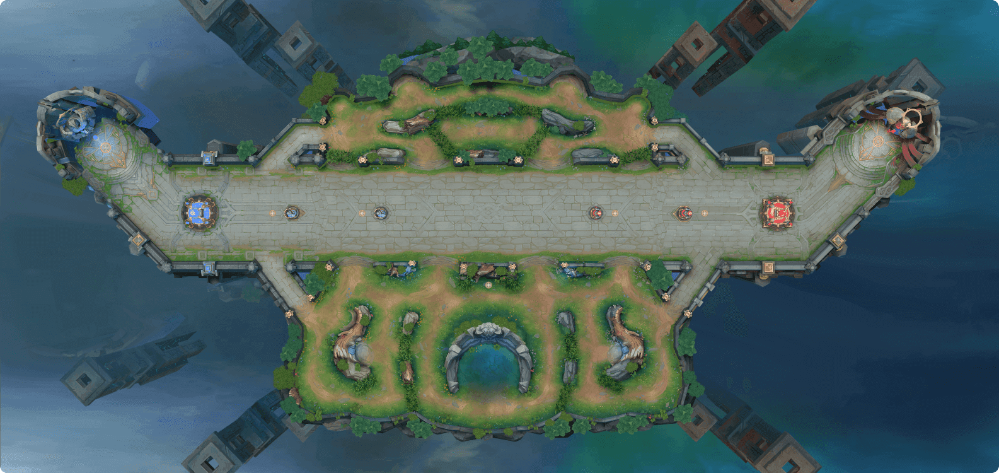

# 项目简介

## 任务目标

训练一个智能体控制己方两名英雄，并通过协作指令调度一名官方智能体英雄完成 3v3 长平攻防战。任务目标是摧毁敌方水晶，率先摧毁敌方水晶的一方获胜。

本赛题主要考察多智能体通信协作能力。官方智能体英雄不主动参战：无有效指令期间将向己方泉水移动；收到有效协作指令后按指令行动；指令结束或被中断后回到向己方泉水移动状态。

## 环境介绍

### 地图

长平攻防战是一张单路 3v3 地图，包含兵线主路、上部野区、下部野区、双方复活点、水晶、防御塔、血包和加速 BUFF。

### 元素介绍

| 元素名称 | 描述 |
| --- | --- |
| **英雄** | 任务中智能体、官方智能体或对手模型控制的作战单位。 |
| **复活点** | 红蓝双方英雄复活位置。英雄被击败后从复活点复活重新进入战斗。 |
| **水晶** | 阵营核心建筑。位于复活点前方，是双方阵营的核心建筑。水晶周期性生成己方小兵，支持持续推进和防守。摧毁敌方水晶即可获胜。 |
| **小兵** | 自动沿地图中间的道路向敌方阵营推进，遇敌时会自动攻击敌方小兵、防御塔和英雄单位，承担前线作战任务。 |
| **防御塔** | 布置在水晶前方，具备自动攻击进入其攻击范围内的敌方英雄和小兵的能力，是保护水晶的重要防御设施。 |
| **野区** | 打野英雄获得经济收益和经验收益的主要来源。地图中包含了一个上部野区和下部野区，红蓝双方阵营的玩家共享整块野区，但部分野区入口有阵营限制。 |
| **血包** | 红蓝双方的**防御塔后方**均会刷新供所有英雄使用的​**血包**​。英雄在使用血包后，它会在一定时间后重新刷新。然而，一旦防御塔被摧毁，其后方的血包将消失且不再刷新。 |
| **加速 BUFF** | 在地图主宰上方区域，会生成一个​**加速BUFF**​。英雄获取后可以获得一段时间的额外加速效果。该BUFF会在一定时间后刷新。 |
| **暗夜狼BUFF** | 当英雄击败野区上方的野怪（暗夜狼）时，英雄将获得一段时间的额外加速效果，并在此期间减少一定的技能冷却时间。 |
| **暴君** | 击败暴君将为击杀方阵营的所有英雄带来增益效果。击杀一次暴君可增加生命回复；击杀两次暴君可增加对防御塔的伤害；击杀三次暴君可提高伤害输出。 |
| **英雄技能** | 每个英雄独有的能力，包括被动和主动技能。技能决定了英雄在游戏中的表现和作用，比如输出伤害、控制敌人、辅助队友或增强自身属性。 |
| **召唤师技能** | 英雄的额外辅助技能，能够在战斗中提供位移、治疗、加速等多种战术支持。 |

### 英雄介绍

本环境使用三名英雄：马可波罗、貂蝉、铠。每局中，选手模型控制其中两名英雄，剩余一名英雄由官方智能体控制。

| 英雄 | 英雄 ID | 定位 | 召唤师技能 | 特点 |
| --- | --- | --- | --- | --- |
| 马可波罗 | 132 | 射手 | 闪现 80115 | 持续输出强，普攻与技能可叠加破坏效果。 |
| 貂蝉 | 141 | 法师 | 闪现 80115 | 技能命中可叠加印记，具备持续作战和范围输出能力。 |
| 铠 | 193 | 战士 | 惩击 80104 | 单体伤害高，适合打野、游走和收割。 |

#### **马可波罗**

- 英雄技能

|  | 技能名称 | 技能ID | 技能描述 |
| --- | --- | --- | --- |
| 被动技能 | 连锁反应 | 13200 | 马可波罗的普攻与技能伤害会叠加破坏效果，每层造成15（+1%目标最大生命值）真实伤害（对野怪上限80），叠满10层后触发爆炸，额外造成90（+30%物理攻击）真实伤害。 |
| 一技能 | 华丽左轮 | 13210 | 马可波罗向指定方向射击，每发子弹造成70/80/90/100/110/120（+30%物理攻击）物理伤害，命中后回复10点能量，最多连续射击5次。 |
| 二技能 | 漫游之枪 | 13220 | 马可波罗向指定方向翻滚，并强化接下来3秒内的普攻，造成35/42/49/56/63/70（+15%物理攻击）物理伤害。若子弹命中敌方英雄，减少漫游之枪1秒冷却时间。 |
| 三技能 | 狂热弹幕 | 13230 | 马可波罗向周围发射弹幕，持续5秒，每发子弹造成60/80/100（+20%物理攻击）物理伤害。期间可移动但降低15%移速，若命中敌方英雄则提升自身30%移速，持续2秒。 |

- 召唤师技能-**闪现** （详细信息见[召唤师技能](#%E5%8F%AC%E5%94%A4%E5%B8%88%E6%8A%80%E8%83%BD)）

#### **貂蝉**

- 英雄技能

|  | 技能名称 | 技能ID | 技能描述 |
| --- | --- | --- | --- |
| 被动技能 | 语·花印 | 14100 | 貂蝉的技能命中会叠加花之印记，每层持续8秒，叠满4层后触发爆炸，回复自身120（+25%法术攻击）生命值，并对周围敌人造成240（+50%法术攻击）真实伤害。 |
| 一技能 | 落·红雨 | 14110 | 貂蝉向前抛出花球，造成180/220/260/300/340/380（+50%法术攻击）法术伤害，返回时造成等量伤害并叠加印记。 |
| 二技能 | 缘·心结 | 14120 | 貂蝉瞬移至指定位置，散发3枚花球攻击附近敌人，每枚造成140/155/170/185/200/215（+24%法术攻击）法术伤害并叠加印记。命中敌人减少该技能4秒冷却时间。 |
| 三技能 | 绽·风华 | 14130 | 貂蝉绽放法阵持续12秒，范围内每1秒造成75/100/125（+15%法术攻击）法术伤害并叠加印记。开启和结束时各造成200/300/400（+50%法术攻击）法术伤害。法阵内貂蝉的1/2技能冷却加快50%。 |

- 召唤师技能-**闪现** （详细信息见[召唤师技能](#%E5%8F%AC%E5%94%A4%E5%B8%88%E6%8A%80%E8%83%BD)）

#### **铠**

- 英雄技能

|  | 技能名称 | 技能ID | 技能描述 |
| --- | --- | --- | --- |
| 被动技能 | 修罗之魂 | 19300 | 铠的普攻与极刃风暴只命中一个目标时，会额外造成50%伤害。脱离战斗后每秒回复1%最大生命值及法力值，同时增加10点移速。 |
| 一技能 | 回旋之刃 | 19310 | 铠投掷刀刃，对路径敌人造成200/240/280/320/360/400（+80%物理攻击）物理伤害并减速30%，持续2秒。刀刃返回时回复铠10%已损生命值并减少极刃风暴3秒冷却时间。 |
| 二技能 | 极刃风暴 | 19320 | 铠向前挥砍，造成80/100/120/140/160/180（+50%物理攻击）物理伤害，第二刀造成额外击飞效果0.5秒，同时强化下一次普攻冲锋至目标并额外造成150/180/210/240/270/300（+60%物理攻击）物理伤害。被动：脱离战斗后每秒回复1%最大生命值，并增加10/12/14/16/18/20点移速。 |
| 三技能 | 不灭魔躯 | 19330 | 铠召唤魔铠，持续8秒，期间获得80/120/160点物理攻击、50/75/100点法术抗性，并对周围敌人每0.5秒造成60/90/120（+30%物理攻击）法术伤害。首次开启时对周围敌人造成300/450/600（+120%物理攻击）法术伤害。 |

- 召唤师技能-**惩击** （详细信息见[召唤师技能](#%E5%8F%AC%E5%94%A4%E5%B8%88%E6%8A%80%E8%83%BD)）

### 召唤师技能

| 技能名称 | 技能ID | 技能描述 |
| --- | --- | --- |
| 闪现 | 80115 | 120秒CD：向指定方向位移一段距离。 |
| 惩击 | 80114 | 30秒CD：对身边的野怪和小兵造成1500点的真实伤害并眩晕1秒。 |

### 阵容轮换

完整一轮评估包含 18 小局。己方三种阵容分别对战对方三种阵容，并进行换边。

| 阵容 | 选手模型控制 | 官方智能体控制 |
| --- | --- | --- |
| 阵容 A | 马可波罗、貂蝉 | 铠 |
| 阵容 B | 马可波罗、铠 | 貂蝉 |
| 阵容 C | 貂蝉、铠 | 马可波罗 |

## 官方智能体被动响应机制

| 状态 | 行为 |
| --- | --- |
| 无有效指令 | 官方智能体英雄向己方泉水移动，不主动参与战斗、不主动游走、不主动释放技能。 |
| 收到有效指令 | 官方智能体英雄按指令内容行动，技能释放与战斗能力不弱化。 |
| 指令结束 | 指令持续时间结束后，如无新的有效指令，官方智能体英雄回到向己方泉水移动状态。 |
| 收到中断指令 | 官方智能体英雄将停止当前行动，并回到向己方泉水移动状态。 |
| 官方智能体死亡 | 死亡不会自动清除当前通信指令或通信状态。选手可通过发送中断指令或新指令取消、覆盖旧指令。 |

## 评分规则

每局以水晶是否被摧毁判定胜负。胜利得 1 分，失败或超时得 0 分。最终分数基于多局胜负结果统计。

## 注意事项

- 官方智能体英雄只响应有限集协作指令。
- 若发送目标对象指令时目标单位一开始就是无效单位，该指令按无效指令处理，不计入指令冷却，不更新通信状态。
- 指令冷却期内发送的新指令会被判定为无效指令。
- 评估任务使用官方统一配置，选手无法修改评估任务中的指令配置。
- 不允许修改英雄召唤师技能、装备、铭文等配置。
- 提交的最终模型大小不得超过 60MB。

---
