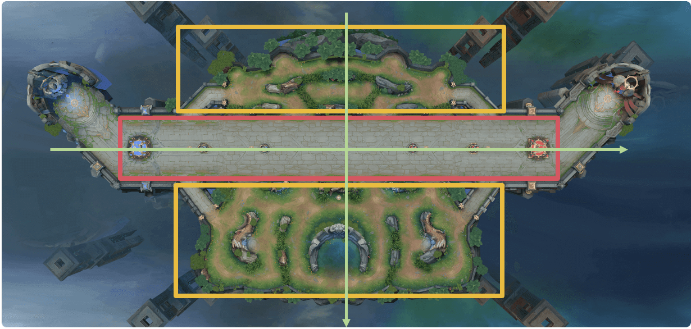
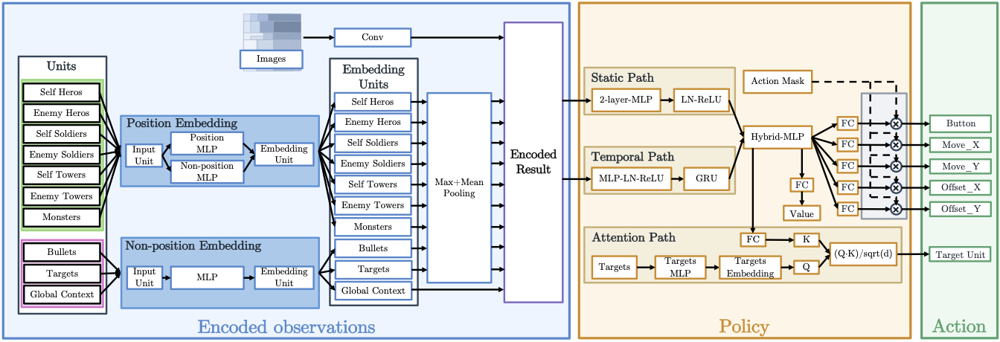
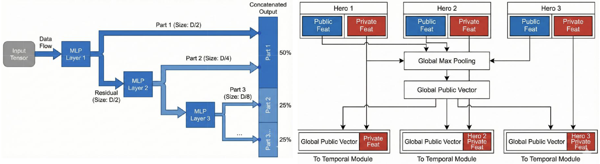

# 王者荣耀 3v3

基于腾讯开悟平台的多智能体协作项目。模型直接控制两名英雄，并通过独立的团队指令策略调度一名官方队友，围绕对线发育、野区资源、团队交战和建筑推进完成决策，以摧毁敌方水晶为最终目标。

当前实现采用图像与结构化特征融合、团队与个体双路 PSCN、GRU、英雄专属策略头、条件目标注意力、混合价值估计和 Dual-clip PPO，并配合动作合法化与任务状态机。

## 任务简介

三人阵容由马可波罗（132）、貂蝉（141）和铠（193）组成。每局其中两名英雄由模型直接控制，另一名由官方智能体控制；不同阵容决定模型承担的英雄组合。

直接控制英雄需要输出移动、攻击、技能及目标，官方队友则通过指定目标、指定位置或中断等协作指令调度。没有有效指令时，官方队友会向己方泉水移动，因此指令策略也是任务的一部分。

胜利条件为摧毁敌方水晶，评价以多局胜负为依据。详细任务说明见[项目介绍](PROJECT_INTRODUCTION.md)。

## 地图与空间表示



图中红框表示主路，黄框表示上下野区，绿色轴说明沿主路与横向区域的空间关系。代码在统一坐标下分别描述兵线推进、野区入口和关键资源，不直接把示意框作为固定通行边界。

### 阵营统一与区域编码

当前位置先转换到统一阵营视角：己方作为主路一侧，红方反转 x 轴，z 坐标减去主路中心偏移 6115。这里不沿用 1v1 的对角线旋转，也不同时反转两个轴。

```text
side_x = raw_x（阵营 1）或 -raw_x（阵营 2）
side_z = raw_z - 6115
```

全图位置按 x 轴 ±70000、z 轴 ±35000 归一化，并提供 11 桶和 9 桶的粗粒度位置编码。语义区域进一步区分己方基地、塔区、双方兵线、中路、敌方基地、上下野区、暴君区和加速增益区。

### 动态主路与关键区域精细编码

主路位置不仅使用固定地图坐标，还根据双方当前有效建筑边界构造动态推进坐标。每个英雄有一个 72 维动态主路位置块，包含边界类型、边界位置、推进比例、61 桶位置和桶内残差。随着防御塔被摧毁，位置语义可随实际推进阶段改变。

暴君附近另外提供 54 维精细位置块，包含相对位移、距离、两个方向各 21 桶编码，以及己方入口、敌方入口和坑内等拓扑标记。资源与野区移动还使用测量锚点和入口连接关系，避免只按直线方向穿过不可通行墙体。

当前空间建模由全图粗位置、动态主路、关键资源局部位置和图像特征共同组成，并非一套固定二维栅格覆盖所有决策。

## 状态特征

每名可控英雄每个时刻输入 **10157 维**特征，其中图像特征 1734 维，结构化特征 8423 维。两个可控英雄分别构建观测，网络张量布局为 `[batch, actor=2, time, feature]`。

| 特征块 | 形状 | 维度 | 主要内容 |
| --- | --- | --- | --- |
| 局部图像 | 6 × 17 × 17 | 1734 | 环境图像通道 |
| 英雄 | 6 × 393 | 2358 | 双方三名英雄的身份、状态、技能和关系信息 |
| 小兵 | 20 × 56 | 1120 | 双方兵线实体 |
| 机关 | 6 × 48 | 288 | 双方外塔、高地塔与水晶 |
| 野怪 | 20 × 60 | 1200 | 固定槽位资源状态 |
| 子弹 | 10 × 32 | 320 | 子弹与局部威胁 |
| 候选目标 | 39 × 48 | 1872 | 动作和协作目标的实体表示及合法性 |
| 英雄关系 | 6 × 24 | 144 | 相对于当前可控英雄的关系 |
| 动态主路位置 | 6 × 72 | 432 | 建筑边界与推进位置 |
| 暴君局部位置 | 1 × 54 | 54 | 暴君附近的精细几何与拓扑 |
| 暴君团队上下文 | 1 × 24 | 24 | 团队争夺状态 |
| 兵线状态 | 1 × 96 | 96 | 兵线接触、建筑压力与掩护 |
| 资源锚点 | 5 × 32 | 160 | 资源位置、时间与到达信息 |
| 协作状态 | 1 × 64 | 64 | 官方队友、当前指令与反馈 |
| 全局状态 | 1 × 128 | 128 | 阵营与全局局面 |
| 打野计划 | 1 × 67 | 67 | 打野路径与阶段信息 |
| 对线计划 | 1 × 64 | 64 | 上线、兵线和交战目标 |
| 当前英雄上下文 | 1 × 32 | 32 | 当前控制英雄与官方英雄身份 |
| 合计 | | **10157** | |

英雄槽按英雄 ID 与阵营固定排列，资源和动作目标也有各自协议槽位，避免因距离排序变化导致目标编号漂移。不可见、缺失和无效实体通过对应字段及掩码处理。

## 网络结构



图示说明普通动作网络的主要路径。当前代码还包含团队与个体双路 PSCN、三个英雄的独立输出路由、混合价值与辅助价值，以及独立团队指令网络；下文以实际实现补全这些部分。

### 图像与实体编码

图像分支使用轻量 CNN，卷积通道为 `6 → 18 → 12`，经过池化后将 `12 × 8 × 8` 特征映射为 128 维表示。

结构化分支按实体类型使用共享 MLP，例如英雄编码为 128 维，小兵、机关、野怪、子弹和资源编码为 32 维，候选目标编码为 64 维。可变数量实体采用带有效掩码的 Max + Mean Pooling；英雄、机关等固定槽位则按定义拼接，保留身份与阵营语义。

### 团队与个体双路 PSCN



左图展示逐层保留部分特征、继续处理剩余特征并拼接输出的思路；右图展示通用的公私有特征共享方式。当前代码采用下述独立团队与个体残差 PSCN，不直接照搬右图的三英雄全局 Max Pooling 结构。

编码后形成两类输入：

- **团队输入，1560 维**：英雄、兵线、建筑、野怪、资源、协作状态和全局态势等信息。
- **个体输入，921 维**：当前图像、英雄相对关系、动态位置、局部子弹与目标、打野与对线计划、当前英雄上下文。

两路各自通过独立参数的残差 PSCN，输出 256 维。PSCN 先投影到 256 维，再逐层拆分输出分量：128 维直接保留，剩余部分继续处理为 64 维和 64 维，拼接后通过残差投影与初始表示相加，最后 LayerNorm。

这属于分层特征提取与残差融合。当前代码并不是把三个英雄的公有特征简单堆叠后做一次全局 Max Pooling；团队输入与实体池化、固定身份槽位、个体上下文分别管理。部分公共原始字段还会检查两名可控英雄观测间的一致性。

### 静态分支与 GRU

团队与个体表示拼接为 512 维，投影到 256 维，再分别进入静态与时序路径：

```text
每名可控英雄的图像与结构化特征
    ├── 团队输入 1560 → Residual PSCN → 256
    └── 个体输入  921 → Residual PSCN → 256
                         ↓ 拼接 512
                      投影到 256
    ├── 静态 MLP：256 → 128 → 128
    └── 时序投影：256 → 128 → GRU（隐藏维度 128）
                         ↓ 拼接 256
                      策略特征 256
```

训练序列长度为 16，每名可控英雄维护自己的 GRU 状态，并支持序列内部的重置掩码。部分兼容配置仍使用 `LSTM_*` 字段名，但当前活动网络实际为 GRU。

### 英雄策略路由与条件目标注意力

共享骨干后，根据当前英雄 ID 路由到马可波罗、貂蝉或铠的专属策略头。普通动作有五个子头，维度为 `[13, 25, 42, 42, 39]`，对应动作类别、移动方向、技能偏移和目标。

目标选择依赖动作类别：网络为各按钮构造条件 query，与 39 个目标的 key 做缩放点积，形成按钮条件下的目标分数。实际采样先确定按钮，再使用相应目标合法集合。技能不需要的子动作通过有效标记控制训练贡献。

这种设计让不同英雄共享局面理解，同时保留各自技能与目标选择的差异。

## 团队指令策略

普通动作控制两名选手英雄，团队指令则调度剩余的官方英雄。当前系统每个阵营只有一个团队指令输出，不让两名可控英雄分别发送互相冲突的独立命令。

### 指令输入与输出

指令网络将两名可控英雄的策略表示按 132、141、193 的固定身份槽组织，并补入官方英雄表示，再结合团队特征形成 1024 维输入，经过 MLP 得到指令表示。它没有独立的指令 GRU，但会使用普通策略分支的时序信息。

指令包含三个子头：

| 子头 | 维度 | 含义 |
| --- | --- | --- |
| 意图 | 11 | 不发指令、中断、集火英雄、攻击建筑、关键资源、推线、集合、防守、撤退、攻击野怪、前往或等待野点 |
| 对象目标 | 39 | 与目标实体槽对应的对象选择 |
| 语义位置 | 30 | 英雄位置、兵线前沿、建筑、泉水、暴君集合点及野怪锚点等 |

对象与位置分数均以意图为条件，只有相应意图需要的子头才参与采样和策略损失。不存在合法子目标的意图会被屏蔽，避免出现“选中攻击意图却没有合法目标”的组合。

### 指令执行与反馈

语义意图经过协作合法化器转换为官方协议中的指定目标、指定位置、中断或无命令输出。目标槽映射到运行时实体 ID，位置槽映射到当前锚点坐标；同时检查冷却、目标存活与可见性、位置有效性和当前任务状态。

指令系统会记录官方队友是否向目标推进、锁定目标、进入范围、首次命中，以及是否长期没有响应。训练既关注发出了什么指令，也关注官方队友实际完成了什么任务，减少重复发令和无效等待。

## 价值估计与 PPO 训练

### 混合主价值与辅助价值

普通策略的主价值由三个隐含分量组合：

`V = 0.8 × V_self + 0.2 × V_team - V_enemy`

其中自身分量使用个体特征与 GRU 输出，团队分量使用友方英雄汇总，敌方分量使用敌方英雄、建筑和全局状态。团队及敌方上下文会跨两名可控英雄求平均后广播，以形成一致的部分估值依据。

三个分量通过最终标量回报共同监督，是模型内部的价值分解，不是分别拟合三个可直接观察的真实回报。

另有五类辅助价值：发育、KDA、伤害、推进和胜负。它们由环境 11 项奖励明细分组构造回报目标，用于辅助价值学习，**不直接进入 PPO 策略优势**。团队指令还具有独立的价值头和回报、优势序列。

### Dual-clip PPO

普通动作与团队指令都使用各自有效掩码和旧策略概率计算更新。普通策略使用主回报构造 GAE，负优势样本再通过 Dual-clip 限制过大的负向目标。

| 参数 | 当前值 |
| --- | --- |
| 折扣因子 γ / GAE λ | 0.997 / 0.97 |
| PPO / Dual-clip 系数 | 0.2 / 3.0 |
| 学习率 | 2e-4 |
| 普通主价值 / 辅助价值损失系数 | 0.5 / 0.1 |
| 指令损失 / 指令价值损失系数 | 1.0 / 0.5 |
| 普通与指令熵系数 | 均为 0.015 |
| 最大梯度范数 | 0.5 |
| 有效训练批次 / 微批次 | 1024 / 256 |
| 时序长度 / GRU 隐藏维度 | 16 / 128 |

学习器保留全批次归一化语义，通过微批次累计梯度，减少单次执行的内存压力；配置开启混合精度支持，关键损失计算转为 FP32。

一个打包样本同时保存两个普通动作序列、初始循环状态及一个团队指令序列，总长度为 337664。特征、样本、网络和合法化器的版本签名共同进入检查点协议，旧版模型不应直接按同一格式加载。

## 奖励与工程约束

### 环境奖励与自定义塑形

当前环境配置开启零和奖励，`team_spirit = 0.5`，并使用时间缩放。环境奖励包含生命、经济经验、英雄伤害、野怪伤害及水晶攻击等分量；击杀、阵亡和助攻的一部分反馈由代码侧塑形补充。

野怪攻击奖励按职责配置不同权重：马可波罗为 0.05、貂蝉为 0.005、铠为 0.08，避免所有英雄都长期离线打野。因此当前实现并非所有英雄完全使用相同奖励权重。

代码侧的主要塑形包括：

| 目标 | 反馈设计 |
| --- | --- |
| 对线与发育 | 补刀、上线进度、合理等待与打野路线推进 |
| 资源获取 | 狼营后续生命周期、盗贼、加速增益和暴君结果反馈 |
| 团队交战 | 击杀、阵亡、助攻、支援低血队友、集火和多人参与 |
| 建筑推进 | 建筑血量变化、结果归因、击杀后的推进窗口和水晶终局反馈 |
| 防守 | 敌方兵线压塔、水晶危险、清线与防守任务完成 |
| 行为效率 | 长期静止、低效折返、没有有效攻击目标和任务未响应等约束 |
| 官方队友协作 | 目标锁定、距离推进、首次命中、任务持续与无响应反馈 |

当前自定义水晶终局反馈量级为 ±8。新增塑形主要进入最终标量回报，五类辅助回报保持按官方奖励明细分组的解释，避免把自定义奖励重复混入辅助监督。

### 动作合法化与任务状态机

工程约束主要在采样前修改合法集合，影响网络能够选择的动作，而不只是在采样后替换执行结果。当前实现包含：

- **上线与开局打野**：在保护窗口内约束路线、等待点和资源目标。
- **复活返场**：根据职责与任务重新进入主路或资源区域。
- **安全与碰撞检查**：限制出生区边界、危险塔下动作及受阻移动。
- **闪现与暴君惩击**：结合目标、空间和技能状态控制有效使用范围。
- **后期转化**：根据时间与局势引导集合、推进或防守，避免长期刷资源而不转化为水晶目标。
- **官方英雄指令任务**：处理前往位置、进入交战、目标失效、持续执行、超时和中断等状态。

例如，后期配置包含 12000、15000、18000 帧的阶段阈值；这些阈值属于当前版本的行为先验，效果需要独立评估，不能仅根据代码存在就认为已提升胜率。

## 阵容与对手采样

每轮训练块覆盖双方官方英雄的九种有序组合，并额外重复四种“一侧官方铠、另一侧模型控制铠”的交叉对局，形成 13 局打乱块。其余两名可控英雄随官方英雄身份确定，从而覆盖不同控制职责和对手组合。

当前默认对手为 `selfplay`，监控阵营自动换边。仓库实现了每块 9 局自博弈加 1 局固定模型对手的调度器，但 `OPPONENT_MIX_ENABLED = False`，所以这项混合对手调度当前未启用。

环境内置评估间隔配置得很大，不能据此假定训练期间持续产生对 `common_ai` 的独立评估结果。

## 实验记录

最终比赛阶段记录为全国第 9，对 baseline8 的比分为 4:1。该成绩不代表所有阵容和对手下都具有相同胜率，也不能单独归因于某个网络模块。


## 代码结构

路径相对于 `honor_of_kings_3v3/`：

| 路径 | 内容 |
| --- | --- |
| [agent_ppo/agent.py](../agent_ppo/agent.py) | 双英雄推理、合法化、团队指令与模型加载 |
| [conf/conf.py](../agent_ppo/conf/conf.py) | 活动协议、维度、训练与奖励配置 |
| [feature/schema_v1.py](../agent_ppo/feature/schema_v1.py) | 特征块、字段、实体槽与语义定义 |
| [feature/feature_process/v1_feature_process.py](../agent_ppo/feature/feature_process/v1_feature_process.py) | 图像与结构化观测、空间及任务计划 |
| [feature/feature_process/v1_utils.py](../agent_ppo/feature/feature_process/v1_utils.py) | 阵营坐标、资源锚点、区域与拓扑工具 |
| [model/network_v1.py](../agent_ppo/model/network_v1.py) | CNN、PSCN、GRU、英雄路由、价值和指令网络 |
| [model/command_v1.py](../agent_ppo/model/command_v1.py) | 条件指令采样和合法子头检查 |
| [feature/collaboration_v1.py](../agent_ppo/feature/collaboration_v1.py) | 协作上下文与指令合法化 |
| [feature/v40_legalizers.py](../agent_ppo/feature/v40_legalizers.py) | 复活返场、暴君惩击和后期转化约束 |
| [feature/definition_v1.py](../agent_ppo/feature/definition_v1.py) | 奖励分组、GAE、时序收集及样本协议 |
| [algorithm/algorithm_v1.py](../agent_ppo/algorithm/algorithm_v1.py) | 普通与指令 PPO 损失、微批次训练和诊断 |
| [workflow/train_workflow.py](../agent_ppo/workflow/train_workflow.py) | 阵容轮换、对手配置、样本发送和监控 |
| [agent_ppo_debug](../agent_ppo_debug/) | 复用活动 PPO 的官方英雄技能与指令调试 |

## 运行说明

项目依赖开悟平台的 `kaiwudrl`、`common_python`、`tools` 等模块。活动入口为 `agent_ppo`，`model.py`、`algorithm.py` 等短文件主要承担兼容导出，实际实现集中在上述带 `v1` 后缀的模块。

- `LegacyConfig` 和部分旧特征处理文件保留用于兼容识别，不是当前活动网络的参数来源。
- 当前指令持续时间为 300 帧、冷却为 100 帧，训练阵容由工作流轮换。
- 平台配置当前开启历史模型预加载，但仓库未包含权重，运行前需要配置兼容模型或调整初始化方式。
- 两套入口中，`ppo` 是训练策略，配置中的 `diy` 指向 `agent_ppo_debug` 调试流程，不应当作另一套完整训练算法。
- 修改特征、动作、循环状态或样本格式时，需要同步检查版本签名；部分兼容迁移由检查点加载器显式处理。

## 后续验证

优先在相同阵容、换边与对手设置下评估普通策略和官方队友的联合表现，再分别检查指令有效率、任务响应、资源转化、推塔效率及辅助价值的贡献。当前已实现对手调度、多分量价值与野区计划，后续重点是验证启用条件和实际收益，而非将这些模块当作尚未实现的概念。
